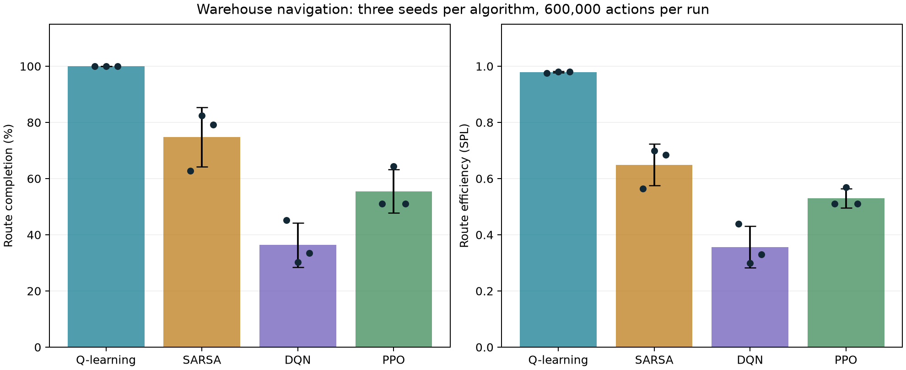

# Autonomous Warehouse Robot Navigation: A Comparative Study of Q-learning, SARSA, DQN and PPO

Measured results, 19 November 2026.

The registered twelve-run study completed **7.2 million training actions**. Every final checkpoint was reloaded and assessed on the same 188 development routes. All 2,256 recorded assessment episodes passed action/dynamics/metric audits. Three independent training seeds contribute equally to each method average. No checkpoint or seed was selected for a favorable result.

## Completion and route efficiency

| Algorithm | Completion, mean +/- seed SD | Collision, mean +/- seed SD | Timeout, mean +/- seed SD | SPL, mean +/- seed SD |
| --- | --- | --- | --- | --- |
| Q-learning | 100.00% +/- 0.00 pp | 0.00% +/- 0.00 pp | 0.00% +/- 0.00 pp | 0.9789 +/- 0.0023 |
| SARSA | 74.82% +/- 10.56 pp | 0.00% +/- 0.00 pp | 25.18% +/- 10.56 pp | 0.6493 +/- 0.0737 |
| DQN | 36.35% +/- 7.84 pp | 18.44% +/- 4.83 pp | 45.21% +/- 5.07 pp | 0.3564 +/- 0.0737 |
| PPO | 55.50% +/- 7.68 pp | 44.50% +/- 7.68 pp | 0.00% +/- 0.00 pp | 0.5304 +/- 0.0342 |

Bars show equal-weight seed means; error bars show sample SD, and dots show individual seeds. SD is not a confidence interval. The same route cases recur for each run; they are not independent training replicates.

## Every training seed

| Algorithm | Seed | Completed / 188 | Collision / 188 | Timeout / 188 | SPL | Repeating-position timeouts |
| --- | --- | --- | --- | --- | --- | --- |
| Q-learning | 19411 | 188 | 0 | 0 | 0.9762 | 0 |
| Q-learning | 19421 | 188 | 0 | 0 | 0.9804 | 0 |
| Q-learning | 19431 | 188 | 0 | 0 | 0.9801 | 0 |
| SARSA | 19411 | 118 | 0 | 70 | 0.5646 | 70 |
| SARSA | 19421 | 155 | 0 | 33 | 0.6986 | 33 |
| SARSA | 19431 | 149 | 0 | 39 | 0.6848 | 39 |
| DQN | 19411 | 85 | 28 | 75 | 0.4394 | 75 |
| DQN | 19421 | 57 | 45 | 86 | 0.2989 | 86 |
| DQN | 19431 | 63 | 31 | 94 | 0.3308 | 94 |
| PPO | 19411 | 96 | 92 | 0 | 0.5106 | 0 |
| PPO | 19421 | 121 | 67 | 0 | 0.5698 | 0 |
| PPO | 19431 | 96 | 92 | 0 | 0.5106 | 0 |

## Interpretation

**Q-learning has the highest measured mean completion under this registered setup.** This describes the reported floor, coordinate representation, action budget and settings; it does not establish that the algorithm is universally best. No post-result tuning was performed.

The floor is small and finite, so an explicit state-action table can represent its robot/goal combinations directly. Neural methods must approximate useful values or actions from scaled coordinates without an obstacle channel. Different exploration/update rules and terminal collisions can produce different learning progress. These are plausible explanations, rather than effects isolated by this experiment.

The common -0.05 step cost discourages unnecessary movement, but deterministic policies can still repeat states and time out. The timeout counter records any repeated position within a timed-out episode; it does not classify a specific cycle or prove that reward design caused it. A causal reward claim would require matched reward ablations with independently registered settings.

The 35-case monitoring curves describe training progress. A later checkpoint can perform worse than an earlier one; the fixed 600,000-action checkpoint remains in the comparison. All failures can be inspected through Simulator > Browse every assessed route.

## Compute and reproducibility

| Algorithm | Mean recorded training seconds | Mean final checkpoint bytes | Mean recorded decision microseconds |
| --- | --- | --- | --- |
| Q-learning | 20.13 | 25331 | 1.72 |
| SARSA | 17.32 | 31819 | 1.72 |
| DQN | 230.44 | 102092 | 46.59 |
| PPO | 289.29 | 143251 | 189.45 |

At most two CPU workers ran concurrently, with one Torch thread per neural worker. Equal environment-action budgets do not imply equal gradient updates, compute or hyperparameter tuning. Timings are descriptive, not isolated hardware benchmarks. Tabular timing excludes setup; neural recorded elapsed time includes setup and excludes measured monitoring. The reused neural ledger metadata contains a generic construction-exclusion label; this report follows the actual warehouse runner timing scope.

The [protocol](warehouse_comparison_protocol.md) and [configuration](../configs/warehouse_comparison.yaml) were frozen before the matrix ran. `freeze.json` and `seal.json` retain exact engine, environment and split hashes. Each run saves final weights, training ledgers, monitoring, six actual training episodes, all 188 assessment trajectories and output checksums. `published.json` pins the [summary](../artifacts/warehouse/warehouse-four-algorithm-v1/summary.json) and [comparison CSV](../artifacts/warehouse/warehouse-four-algorithm-v1/comparison.csv). The earlier seed-19301 warehouse pilot is excluded.

## Evidence boundaries

These are **previously inspected development routes on one familiar warehouse**. Initial training and assessment pairs are disjoint, but trajectories can visit overlapping states. Named jobs and the monitoring subset are part of development assessment. This is not a fresh final holdout, unseen-warehouse evaluation or physical-robot safety assessment. Three seeds provide limited variability evidence and no statistical significance claim.

The point-robot simulation has four grid moves and static fixtures. It does not model loading parcels, robot footprint, sensors, continuous motion, people, moving obstacles or battery use. Temporary 3D preview changes rendering only. Historical final cohorts were neither rerun nor overwritten.

For operation and implementation details, see the [user and code guide](../../docs/user-guide.md), [technical report](technical_report.md) and [verification guide](../../docs/developer-guide.md).
