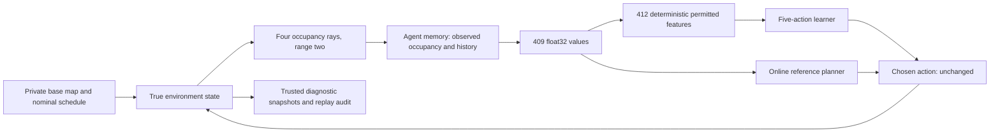

# Partial-observation dynamic indoor navigation: environment specification

Namespace: `partial-dynamic-navigation-v1`. Implementation date: 20 November 2026.
This extends the repository; it does not redefine any historical environment.

## Identity and input boundary

| Component | Version |
| --- | --- |
| Environment | `partial-dynamic-env-v1` |
| Observation | `partial-memory-409-v2` |
| Sensor | `cardinal-rays-range2-v1` |
| Actions | `up-down-left-right-wait-v1` |
| Rewards | `partial-step-goal-collision-v1` |
| Common feature transform | `partial-visible-affine-v1` |

The exact configuration also contributes a task hash. Layout/event identities
belong to scenario records, not agent inputs. All maps are 10 by 10. Policies
know exact position, goal coordinates and dimensions, but no hidden occupancy.

No policy/helper/extractor takes a grid, environment, scenario ID, event seed,
schedule or diagnostic snapshot. The reference planner consumes only the same
409-value vector. Gymnasium `info` contains only outcome and elapsed steps.
SB3 adds its usual vector/autoreset metadata outside that interface. Python
private attributes are an architectural boundary, not a hostile-code sandbox.

## Sensor and memory

Ray order is North, South, East, West. Each ray reveals up to two cells, stopping
at the first blocked cell. Occupancy classes do not distinguish permanent walls
from temporary obstacles. Scalar distances are 0 for no obstacle within range,
0.5 for distance one and 1 for distance two. Boundaries produce these virtual
distance readings without adding an outside cell to memory. The origin is
included as an observed free cell; occupied-cell suppression keeps it free.

Memory has occupancy (-1 unknown, 0 last observed free, 1 last observed blocked),
last-seen time, movement-entry visit counts, continuous blocked-observation
streaks and a current-scan mask. Start is visited once; Wait and collisions do
not add visits. Only actual sensed cells change occupancy/timestamps. Invisible
cells retain occupancy, but their blocked streak resets to zero. A reappearing
blocked reading begins a streak of one. All memory is cleared at reset.

## Observation and features

The float32 Box has bounds [-1, 1] and shape (409,). Coordinates [0:4] are divided
by nine; [4:8] contains ray distances. Row-major arrays follow: occupancy
[8:108], observation age [108:208], visits [208:308], blocked streak [308:408].
Age clips at 20 and divides by 20; unseen age is zero, distinguished by unknown
occupancy. Visits/streak clip at five and divide by five. [408] is elapsed time
clipped at 200 and divided by 200. Elapsed time is history context, not a hidden
blockage countdown. This implementation restricts the external cap to 1–200;
larger-cap research needs a separately considered encoding/task configuration.

All four learners receive the same deterministic 412 features: bias, the 409
values and two relative-goal coordinates derived from those values. Linear
methods have a 5 by 412 weight matrix with normalized semi-gradient updates.
Neural models use a vectorized equivalent transform and their own hidden layers.
This provides equal information access, not equal representational capacity.
There is no unknown-cell-as-free conversion in the learned input, action mask,
planner fallback or forced loop recovery. Deterministic evaluation uses first
argmax on ties for the linear policies.

## Time, events and rewards

Actions are 0 Up, 1 Down, 2 Left, 3 Right, 4 Wait. At reset, apply t=0 events,
create memory, mark start visited and scan. An action is executed against the
occupancy that produced the decision-time observation. Then time advances once.
For a nonterminal transition, apply t+1 events and scan once. **External
truncation also receives this continuing t+1 state**, so its bootstrap observation
includes next-time events. For a natural goal/collision terminal, do not apply
new events; scan the executed occupancy at the final position/time. This final
scan is deterministic and has no further decision. The truncation convention
clarifies the brief's “if continuing” recommendation using continuing-MDP
semantics rather than treating the external experimental cap as a deadline.

Events occupy half-open integer intervals [start, clear), only on base-free
cells, excluding start/goal. They have finite windows and no simultaneous
same-cell overlap. Nominal schedules depend on declared geometry/event seeds,
never actions. At each active tick, skip occupancy at the robot's cell and log
suppression without shifting or extending the window. The event may apply on
the next tick if the robot has moved. Nominal and realized events can therefore
differ across trajectories and are both recorded.

Each action, including Wait, costs -0.01. Goal adds 10 (total 9.99); collision
adds -5 (total -5.01) and leaves position unchanged. Goal/collision terminate;
the provisional cap of 200 truncates otherwise. There is no timeout penalty,
coverage reward, hidden-distance shaping or automatic action replacement.

## Reference and diagnostic metrics

The online reference replans every decision on the remembered map. Unknown
cells are optimistic hypotheses; stale blocked cells become reconsiderable
after four steps. Fresh blocked neighbors are never entered. It prefers an
available route over waiting, otherwise tries an unvisited free neighbor or
Waits for a fresh scan. It has no obstacle-type classification or future-duration
estimate. It may explore poorly or wait at a permanent obstacle; this heuristic
is not claimed optimal. Always-Wait and seeded random policies are diagnostic
references, not learned models.

Metrics count elapsed actions, including Wait, and keep all failures. Report
success/collision/timeout, return, moves, waits/proportion/longest wait streak,
movement-entry revisits, overlapping four-position A-B-A-B windows (excluding
stationary waits), and longest interval without a new best Manhattan distance.
These position diagnostics do not prove pathological policy cycles: detours and
useful revisits can score on them. Coverage is observed cells / 100, not fraction
of hidden free cells. Refresh/correction counts include initial and final scans.

An event is detected when its actually applied cell is scanned blocked. A
**recovery opportunity** is a distinct detected event whose cell lies on the
deterministic base-map BFS route from the position at detection to the goal.
This is a trusted, retrospective relevance definition, not agent information.
Recovery occurs at the first later entry into that event cell, or goal arrival
by a detour. Delay is elapsed actions from relevant detection. Aggregate rate
is recoveries / opportunities; zero opportunities yields null, not zero success.
The denominator excludes unseen events and is conditional on each trajectory;
it is not a causal measure of adaptation. Both scheduled and applied event
counts and unobserved counts are reported. Suppression counts are active ticks,
not unique event counts.

`posthoc_waits_with_open_route` counts Wait decisions for which a currently open
true-map route exists. It is an information-advantaged opportunity diagnostic,
**not proof waiting was unnecessary or suboptimal**, since subsequent events and
information gathering matter. Successful movement excess over the static base
path is also descriptive. No dynamic SPL, dynamic optimum or RL-over-planning
claim is computed. Historical SPL and reports remain unchanged.
