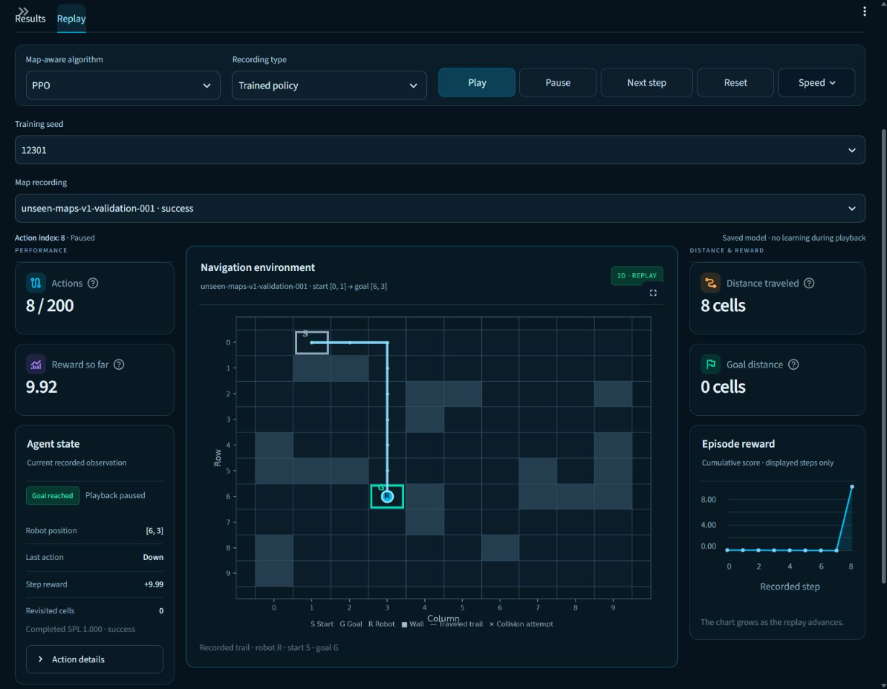

# Milestone 11. Shared-feature unseen-map development results

Completed 10 November 2026 under the [registered protocol](milestone11_protocol.md).
The owner selected shared features for all four algorithms. Four engineering
pilots and twelve main runs completed without failed or retried attempts.
All saved evidence passed the action/provenance audit.

## Executed design

The immutable benchmark retains 12 training layouts, four development-validation
layouts and ten reserved final layouts. Each layout has 48 routes and 79 connected
free cells. Training uses 576 possible routes. Every selected policy is evaluated
on all 192 validation routes and a separate 72-route familiar-layout probe.
Core rewards, movement rules, collision termination and the 200-action cap are
unchanged from the registered unseen-map benchmark.

All four algorithms use the same 1,234 deterministic features derived from the
104-value raw map/coordinate observation. Features retain the full obstacle map
and goal, centered on the robot, with relative-goal encoding, local obstacle
patterns and map-derived cardinal clearance. Q-learning and SARSA use normalized
semi-gradient linear action values. DQN and PPO use fixed feature extraction and
64×64 neural networks. Their capacities differ.

Engineering pilots each used seed 12007 and 25,000 steps. Main runs each used
200,000 steps for seeds 12101, 12203 and 12301. Total training was exactly
2,500,000 transitions, including 100,000 pilot transitions and 2,400,000 main
transitions. Pilots provide implementation/runtime checks and did not select
settings or remove a family.

Monitoring used the same 24 development cases every 12,500 steps. Selection
maximized success, then SPL, then preferred the earliest checkpoint. The main
runs each had sixteen selection opportunities. Development validation has been
used for selection. Final-layout policy executions remain zero.

## Actual main results

Means and sample SD are across three training seeds. Each algorithm has 576 policy–route outcomes across its three policies.

| Algorithm | Success % ± SD points | Collision % | Timeout % | SPL ± SD | Familiar success % |
|---|---|---|---|---|---|
| Q-learning | 18.92 ± 2.46 | 0.17 | 80.90 | 0.1855 ± 0.0217 | 21.76 |
| SARSA | 63.37 ± 2.17 | 0.69 | 35.94 | 0.6236 ± 0.0199 | 71.30 |
| DQN | 33.51 ± 8.14 | 0.00 | 66.49 | 0.3275 ± 0.0791 | 53.24 |
| PPO | 73.96 ± 5.44 | 0.17 | 25.87 | 0.7315 ± 0.0532 | 77.31 |

| Algorithm | Successes | Collisions | Timeouts | Routes | Successful length ± SD |
|---|---|---|---|---|---|
| Q-learning | 109 | 1 | 466 | 576 | 3.26 ± 0.37 |
| SARSA | 365 | 4 | 207 | 576 | 6.11 ± 0.21 |
| DQN | 193 | 0 | 383 | 576 | 4.32 ± 0.89 |
| PPO | 426 | 1 | 149 | 576 | 6.96 ± 0.14 |

All four mean collision rates meet the 2% threshold. Every family misses the
80% success and .75 SPL targets on its three-seed mean. Most failures are
timeouts. The replay can therefore still show repeated states for weak policies.
PPO has the highest observed mean success in this development comparison.
Its third seed falls to 67.71%, showing why the first completed seed is
insufficient for a stable ranking.

Successful-route lengths are conditional on success and are equal-weight means
of defined seed means. All three seed means are defined for every family.
Q-learning averages 3.26 actions among its successes while failing 467 of 576
policy–route cases. PPO averages 6.96 actions among its successes while failing
150 cases. The shorter conditional Q-learning value reflects a much smaller
set of solved routes and does not establish better overall navigation.

Routes from the same policy/layout are dependent. Three training seeds provide
limited uncertainty information, and four development layouts provide limited
layout coverage. Standard deviations describe training-seed variation.

## Every main seed

| Algorithm | Seed | Successes / 192 | Success % | Collision % | Timeout % | SPL | Selected step |
|---|---|---|---|---|---|---|---|
| Q-learning | 12101 | 40 | 20.83 | 0.00 | 79.17 | 0.2036 | 12500 |
| SARSA | 12101 | 125 | 65.10 | 1.56 | 33.33 | 0.6409 | 200000 |
| DQN | 12101 | 50 | 26.04 | 0.00 | 73.96 | 0.2528 | 125000 |
| PPO | 12101 | 147 | 76.56 | 0.00 | 23.44 | 0.7549 | 137500 |
| Q-learning | 12203 | 31 | 16.15 | 0.00 | 83.85 | 0.1615 | 12500 |
| SARSA | 12203 | 117 | 60.94 | 0.00 | 39.06 | 0.6019 | 187500 |
| DQN | 12203 | 81 | 42.19 | 0.00 | 57.81 | 0.4104 | 200000 |
| PPO | 12203 | 149 | 77.60 | 0.00 | 22.40 | 0.7688 | 62500 |
| Q-learning | 12301 | 38 | 19.79 | 0.52 | 79.69 | 0.1914 | 12500 |
| SARSA | 12301 | 123 | 64.06 | 0.52 | 35.42 | 0.6280 | 200000 |
| DQN | 12301 | 62 | 32.29 | 0.00 | 67.71 | 0.3194 | 12500 |
| PPO | 12301 | 130 | 67.71 | 0.52 | 31.77 | 0.6706 | 62500 |

## Results by validation layout

Each entry averages three policies on the same 48 routes per layout.

| Algorithm | Layout suffix | Success % | Collision % | Timeout % | SPL |
|---|---|---|---|---|---|
| Q-learning | 001 | 19.44 | 0.00 | 80.56 | 0.1877 |
| Q-learning | 002 | 15.28 | 0.00 | 84.72 | 0.1488 |
| Q-learning | 003 | 20.14 | 0.69 | 79.17 | 0.1994 |
| Q-learning | 004 | 20.83 | 0.00 | 79.17 | 0.2060 |
| SARSA | 001 | 74.31 | 0.00 | 25.69 | 0.7335 |
| SARSA | 002 | 54.17 | 0.69 | 45.14 | 0.5344 |
| SARSA | 003 | 59.03 | 2.08 | 38.89 | 0.5823 |
| SARSA | 004 | 65.97 | 0.00 | 34.03 | 0.6441 |
| DQN | 001 | 39.58 | 0.00 | 60.42 | 0.3882 |
| DQN | 002 | 29.17 | 0.00 | 70.83 | 0.2876 |
| DQN | 003 | 32.64 | 0.00 | 67.36 | 0.3228 |
| DQN | 004 | 32.64 | 0.00 | 67.36 | 0.3116 |
| PPO | 001 | 77.78 | 0.00 | 22.22 | 0.7731 |
| PPO | 002 | 61.81 | 0.00 | 38.19 | 0.6086 |
| PPO | 003 | 77.78 | 0.69 | 21.53 | 0.7707 |
| PPO | 004 | 78.47 | 0.00 | 21.53 | 0.7734 |

## Engineering pilots and reference methods

| Algorithm | Seed | Steps | Validation success % | SPL |
|---|---|---|---|---|
| Q-learning | 12007 | 25000 | 25.52 | 0.2496 |
| SARSA | 12007 | 25000 | 44.27 | 0.4319 |
| DQN | 12007 | 25000 | 38.54 | 0.3788 |
| PPO | 12007 | 25000 | 29.17 | 0.2862 |

The exact M10 BFS and Random reference recordings are reused. Their file hashes,
summary identity and prior complete saved-action audit were verified. BFS solves
192/192 routes with SPL 1.000. Random, seed 11003, solves 5/192 with SPL .0226.
The single Random seed has a different support from the three learned-policy
seeds. It remains an untrained reference.

M10 used different inputs, exact-state tables, training budgets and seeds.
Cross-milestone changes are descriptive. This M11 comparison does not isolate
a causal representation effect.

## Measured resources

The two-worker suite took 1255.86 seconds
(20.93 minutes). All sixteen runs fit the
900-second individual limit and the suite fit the 9,000-second limit.
Study files occupy approximately 298.13 MB,
below the 1 GiB limit. No retry budget was consumed.

Execution used CPU, at most two training workers, and one Torch thread per
worker. The machine reports Intel64 Family 6 Model 183 Stepping 1, GenuineIntel and 20 logical
processors on Windows-11-10.0.26200-SP0.

| Algorithm | Optimized parameters | Mean training seconds | Mean total run seconds | Mean selected bytes | Mean decision µs |
|---|---|---|---|---|---|
| Q-learning | 4936 | 50.21 | 63.52 | 36188 | 85.82 |
| SARSA | 4936 | 51.27 | 58.42 | 37201 | 128.24 |
| DQN | 83460 | 283.69 | 333.65 | 2236044 | 470.35 |
| PPO | 166725 | 270.09 | 313.83 | 2472472 | 1137.49 |

Training seconds include collection, environment, learner and ledger work,
with monitoring/checkpoint time subtracted. Total run time includes construction,
monitoring, reload, full validation, familiar probing and export. Concurrent
wall times cannot be added to obtain suite wall time. Latency uses 100 warm
CPU queries per selected policy and depends on machine load and timing overhead.
Optimized parameter counts exclude fixed feature buffers and the DQN target network.
Checkpoints are inference snapshots and exact training resume is unsupported.

## Verification and preservation

The full audit checked 453,723 saved actions across
sixteen runs, including 980
actual learning actions in 48
bounded recordings. All 4,224 full validation/familiar episodes were replayed
through the core environment. Reloaded checkpoint actions and scores or PPO
diagnostics match. Inference fingerprints remain unchanged. Training budgets,
chronological ledgers, monitoring opportunities, checkpoint selection and
periodic snapshot checksums reconcile.

All 184 tests passed in 76.13 seconds. Regression checks include NumPy/Torch
feature parity within 1e-7, hand-calculated terminal/continuing TD updates,
SARSA behavior-action requirements, cross-layout sharing, model reload and
training/evaluation split guards. The UI harness checks all twelve main runs
in both recorded-learning and trained-policy modes, stepping and pause on
study changes.

All 12,772 protected existing artifact/data and root-document files retain their
original hashes. All 184 inputs in the original frozen fixed-map archive pass
their seal. The energy project, sources directory, original plan and root README
remain preserved. Existing M10 evidence is retained byte for byte.

Workers executed the archived source and frozen configuration. The live dashboard
heading was subsequently corrected to cover both unseen-map studies. Training
and verification source hashes are recorded separately.

## Dashboard and reproduction

Open **Unseen maps** and select **Shared features · three seeds**. Results show
four-family means, seed variation, every main seed, per-layout means and the
engineering pilots. Replay provides algorithm, training-seed and recording
selectors. Both actual recorded learning and selected-policy validation replays
use the existing centered map, synchronized state/reward panels and playback controls.
The initial one-seed pilot remains selectable.

Native browser checks passed at the default 1230×956 viewport and a temporary
854×1000 viewport. A PPO learning recording automatically reached its four-action
goal with reward 9.96. Seeking and stepping returned the expected intermediate
state. A selected-policy validation replay reached [6,3] after eight actions,
with reward 9.92 and SPL 1.000. The narrow page has no horizontal overflow,
controls stack, and the map precedes the state panels. The viewport override
was reset after verification.



From the project directory with the environment activated, use the following commands.

```powershell
python -m robot_navigation.unseen_main run
python -m robot_navigation.unseen_main verify
python -m pytest -p no:cacheprovider -q
python -m streamlit run app/streamlit_app.py --server.port 8518
```

The run command reuses a compatible completed study. It retains incomplete
attempts, applies bounded retries to technical failures, and preserves poor
complete seeds. The frozen matrix, protocol, dependencies, source archive,
per-run ledgers, checkpoints, replays and full development trajectories are in
`artifacts/studies/unseen-map-main-v1/`.

The next milestone is a separately frozen independent evaluation on the ten
reserved layouts. Current outcomes are development evidence and retain the
reported performance misses.
