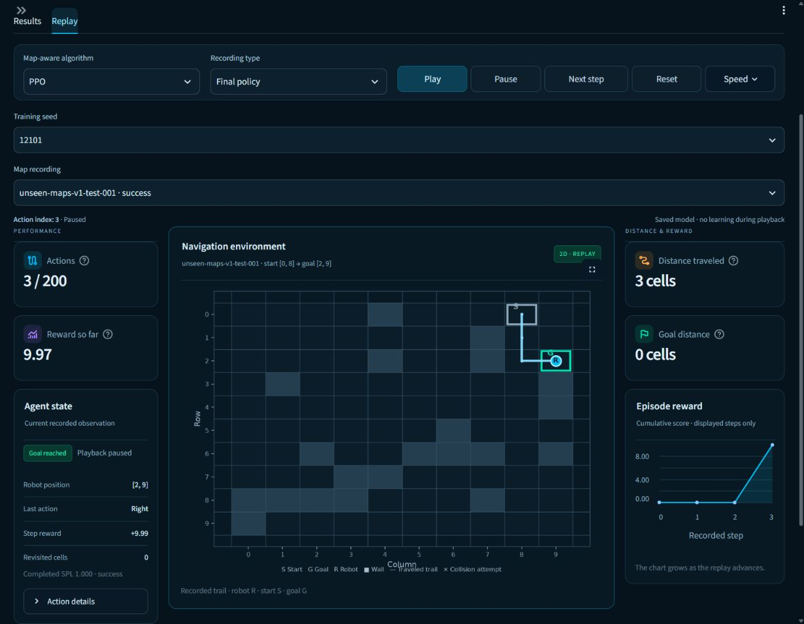

# Milestone 12. Independent unseen-map final evaluation

Completed 10 November 2026 under the [registered protocol](milestone12_protocol.md).
The owner authorized evaluation of the complete M11 roster on the ten reserved
layouts. The release sealed twelve selected checkpoints, task inputs, code,
configuration, references and analysis before the dedicated accessor parsed
final scenarios. All sixteen evaluations and their complete saved-action audit
passed. The existing M11 development records are preserved.

## Frozen design and executed support

The final benchmark contains ten held-out layouts with 48 routes each. Every
learned policy evaluated all 480 routes. Q-learning, SARSA, DQN and PPO retain
training seeds 12101, 12203 and 12301 and their original validation-selected
M11 checkpoint. The shared 1,234-feature representation, task dynamics, rewards,
four actions and 200-action cap are frozen.

Twelve learned policies produced 5,760 policy–route episodes. BFS produced 480
reference episodes. Random used seeds 13109, 13217 and 13309 for 1,440 episodes.
Actual total support is 7,680 episodes and 671,151
environment actions. New training interactions are zero. Every registered run
completed once. There were zero interrupted or repeated canonical attempts.

The release contains 114 sealed input files. The freeze digest is
`dfffd2c2765832fbfb5227a044ac1efc6dfafcc86cb179fe0e3cb2a7baa9bad1`. Workers used archived code and
exact snapshot inputs. Learned policies used deterministic actions and environment
seed zero. Random retained one RNG stream per registered seed across case order.

## Actual final outcomes

Headline values average three training seeds per learned algorithm. Sample SD
measures training-seed variation. The 95% interval resamples ten layout means
conditional on the fixed three-policy roster, using 5,000 draws from seed 13411.
The same layout resamples apply to every method.

| Algorithm | Success % ± seed SD points | Layout 95% interval % | Collision % | Timeout % | SPL ± seed SD |
|---|---|---|---|---|---|
| Q-learning | 16.81 ± 2.09 | 14.65–18.96 | 0.07 | 83.12 | 0.1645 ± 0.0197 |
| SARSA | 62.08 ± 2.37 | 57.85–66.53 | 1.67 | 36.25 | 0.6127 ± 0.0241 |
| DQN | 29.10 ± 6.39 | 26.87–31.94 | 0.00 | 70.90 | 0.2834 ± 0.0625 |
| PPO | 64.10 ± 3.79 | 58.33–69.65 | 1.94 | 33.96 | 0.6312 ± 0.0375 |

| Algorithm | Successes | Collisions | Timeouts | Policy–route cases | Mean return | Successful route length ± seed SD |
|---|---|---|---|---|---|---|
| Q-learning | 242 | 1 | 1197 | 1440 | 0.008 | 3.98 ± 0.28 |
| SARSA | 894 | 24 | 522 | 1440 | 5.360 | 6.35 ± 0.21 |
| DQN | 419 | 0 | 1021 | 1440 | 1.478 | 4.52 ± 0.96 |
| PPO | 923 | 28 | 489 | 1440 | 5.589 | 6.75 ± 0.13 |

Every learned family misses the .80 success and .75 SPL targets on its three-seed
mean. All four mean collision rates meet the .02 limit. SARSA seed 12203 and
PPO seed 12101 each have 11 collisions in 480 routes, or 2.29%, exceeding the
per-policy collision target. Timeouts dominate learned-policy failures.

PPO has the highest observed mean success at 64.10%, with SARSA at 62.08%.
Their layout intervals overlap. Ten layouts and three training seeds provide
limited precision. These intervals condition on the trained policies and the
registered map-generation/task distribution. Routes within a layout/policy are
dependent observations.

Conditional successful-route lengths average the defined seed means, with three
defined values for every learned family. Q-learning solves 242 cases while
failing 1,198. PPO solves 923 while failing 517. Short conditional routes among
Q-learning successes coexist with many unsolved cases. Counts and SPL describe
that difference in overall route coverage.

## All twelve frozen policies

| Algorithm | Training seed | Selected step | Successes / 480 | Collisions | Timeouts | Success % | SPL |
|---|---|---|---|---|---|---|---|
| Q-learning | 12101 | 12500 | 71 | 1 | 408 | 14.79 | 0.1463 |
| SARSA | 12101 | 200000 | 293 | 8 | 179 | 61.04 | 0.6015 |
| DQN | 12101 | 125000 | 111 | 0 | 369 | 23.12 | 0.2223 |
| PPO | 12101 | 137500 | 328 | 11 | 141 | 68.33 | 0.6729 |
| Q-learning | 12203 | 12500 | 80 | 0 | 400 | 16.67 | 0.1619 |
| SARSA | 12203 | 187500 | 290 | 11 | 179 | 60.42 | 0.5964 |
| DQN | 12203 | 200000 | 172 | 0 | 308 | 35.83 | 0.3473 |
| PPO | 12203 | 62500 | 302 | 8 | 170 | 62.92 | 0.6202 |
| Q-learning | 12301 | 12500 | 91 | 0 | 389 | 18.96 | 0.1853 |
| SARSA | 12301 | 200000 | 311 | 5 | 164 | 64.79 | 0.6404 |
| DQN | 12301 | 12500 | 136 | 0 | 344 | 28.33 | 0.2806 |
| PPO | 12301 | 62500 | 293 | 9 | 178 | 61.04 | 0.6003 |

## Development-to-final comparison

| Algorithm | Development success % | Final success % | Change in points |
|---|---|---|---|
| Q-learning | 18.92 | 16.81 | -2.12 |
| SARSA | 63.37 | 62.08 | -1.28 |
| DQN | 33.51 | 29.10 | -4.41 |
| PPO | 73.96 | 64.10 | -9.86 |

Development used four layouts for checkpoint selection. Final evaluation used
ten different layouts. The changes above are descriptive and combine layout
variation with the development-selection setting. PPO's decline is 9.86 points.
Final outcomes were produced after the complete roster and analysis were sealed.

## Per-layout final results

Each learned entry averages three policies on 48 routes per layout, with 144 policy–route cases.

| Algorithm | Layout suffix | Success % | Collision % | Timeout % | SPL |
|---|---|---|---|---|---|
| Q-learning | 001 | 20.14 | 0.00 | 79.86 | 0.2014 |
| Q-learning | 002 | 13.19 | 0.00 | 86.81 | 0.1319 |
| Q-learning | 003 | 20.83 | 0.00 | 79.17 | 0.2083 |
| Q-learning | 004 | 16.67 | 0.69 | 82.64 | 0.1651 |
| Q-learning | 005 | 13.89 | 0.00 | 86.11 | 0.1389 |
| Q-learning | 006 | 13.89 | 0.00 | 86.11 | 0.1343 |
| Q-learning | 007 | 13.89 | 0.00 | 86.11 | 0.1361 |
| Q-learning | 008 | 20.83 | 0.00 | 79.17 | 0.1988 |
| Q-learning | 009 | 22.22 | 0.00 | 77.78 | 0.2176 |
| Q-learning | 010 | 12.50 | 0.00 | 87.50 | 0.1123 |
| SARSA | 001 | 53.47 | 0.00 | 46.53 | 0.5260 |
| SARSA | 002 | 54.17 | 2.78 | 43.06 | 0.5339 |
| SARSA | 003 | 72.92 | 0.00 | 27.08 | 0.7263 |
| SARSA | 004 | 67.36 | 0.00 | 32.64 | 0.6690 |
| SARSA | 005 | 55.56 | 2.08 | 42.36 | 0.5505 |
| SARSA | 006 | 74.31 | 0.69 | 25.00 | 0.7402 |
| SARSA | 007 | 56.94 | 4.86 | 38.19 | 0.5614 |
| SARSA | 008 | 62.50 | 3.47 | 34.03 | 0.6069 |
| SARSA | 009 | 59.72 | 2.78 | 37.50 | 0.5828 |
| SARSA | 010 | 63.89 | 0.00 | 36.11 | 0.6305 |
| DQN | 001 | 29.86 | 0.00 | 70.14 | 0.2930 |
| DQN | 002 | 29.86 | 0.00 | 70.14 | 0.2816 |
| DQN | 003 | 25.00 | 0.00 | 75.00 | 0.2420 |
| DQN | 004 | 40.28 | 0.00 | 59.72 | 0.3962 |
| DQN | 005 | 25.69 | 0.00 | 74.31 | 0.2507 |
| DQN | 006 | 27.78 | 0.00 | 72.22 | 0.2760 |
| DQN | 007 | 25.69 | 0.00 | 74.31 | 0.2523 |
| DQN | 008 | 29.86 | 0.00 | 70.14 | 0.2855 |
| DQN | 009 | 30.56 | 0.00 | 69.44 | 0.2970 |
| DQN | 010 | 26.39 | 0.00 | 73.61 | 0.2597 |
| PPO | 001 | 56.94 | 0.00 | 43.06 | 0.5598 |
| PPO | 002 | 59.72 | 1.39 | 38.89 | 0.5871 |
| PPO | 003 | 75.69 | 0.00 | 24.31 | 0.7543 |
| PPO | 004 | 71.53 | 2.08 | 26.39 | 0.7044 |
| PPO | 005 | 56.94 | 0.00 | 43.06 | 0.5585 |
| PPO | 006 | 75.69 | 0.69 | 23.61 | 0.7484 |
| PPO | 007 | 56.94 | 5.56 | 37.50 | 0.5660 |
| PPO | 008 | 65.97 | 4.86 | 29.17 | 0.6495 |
| PPO | 009 | 47.92 | 4.86 | 47.22 | 0.4764 |
| PPO | 010 | 73.61 | 0.00 | 26.39 | 0.7072 |

## Registered reference methods

| Method | Runs | Successes | Collisions | Timeouts | Cases | Success % ± SD | SPL ± SD |
|---|---|---|---|---|---|---|---|
| BFS | 1 | 480 | 0 | 0 | 480 | 100.00 | 1.0000 |
| Random | 3 | 49 | 1391 | 0 | 1440 | 3.40 ± 0.87 | 0.0285 ± 0.0043 |

BFS solves all 480 routes optimally with SPL 1.000 and zero collisions/timeouts.
Random solves 49 of 1,440 policy–route cases and collides on the other 1,391.
BFS has one deterministic evaluation. Random SD describes evaluation-RNG
variation. Learned SD describes training-seed variation. Their replication
sources differ.

## Runtime, storage and model costs

The complete evaluation took 178.03 seconds. The
independent audit took 22.20 seconds. Release files occupy
approximately 43.67 MB.
Execution fit the registered 3,600-second evaluation and 512 MiB storage limits.
One CPU evaluator used one Torch thread. The recorded machine is
Intel64 Family 6 Model 183 Stepping 1, GenuineIntel on Windows-11-10.0.26200-SP0, with 20 logical processors.

| Algorithm | Parameters | Mean evaluation seconds | Mean decision µs | Checkpoint bytes | Reused training seconds |
|---|---|---|---|---|---|
| Q-learning | 4936 | 6.89 | 47.86 | 36188 | 150.63 |
| SARSA | 4936 | 3.36 | 43.84 | 37201 | 153.82 |
| DQN | 83460 | 23.07 | 283.21 | 2236044 | 851.06 |
| PPO | 166725 | 21.92 | 573.32 | 2472472 | 810.28 |

Decision latency uses 100 warm CPU calls per learned policy after evaluation.
It includes wrapper/feature work and depends on this machine and load. Evaluation
wall time includes trajectories, environment simulation, replay validation and
compression. Total suite time also includes loading, hashing, latency probes and
publication. Evaluation duration varies with actual episode lengths. The complete
M11 training stage already accounted for 2.5 million transitions across its
pilots and main runs. M12 reuses those models. Training costs above refer to the
three reused 200,000-step main runs per family.

Optimized parameter counts exclude fixed feature buffers and the DQN target
network. The linear and neural models have different capacities. Checkpoint
sizes describe serialized inference snapshots. Exact training resume and
cross-machine bitwise repeatability remain outside the verified scope.

## Audit, tests and preservation

The audit replayed all 7,680 episodes and
671,151 saved actions through the core environment.
Reloaded learned actions and Q scores or PPO diagnostics match. Before/after
fingerprints match each frozen learned checkpoint. Exact Random streams and BFS
optimality pass. Recomputed per-route aggregates, seed SD, layout intervals,
example checksums, support and the sealed inputs reconcile.

All 189 regression tests passed in 66.34 seconds. Synthetic releases cover final
access, seal tampering, rejection by ordinary evaluation/training loaders,
retention of partial attempts, complete-result reuse, timeout handling and
cluster-bootstrap calculations. Dashboard tests step every one of the twelve
final policies, restrict final recording mode and pause playback when switching
to development studies. Model loading/queries are forbidden during these
playback tests.

All 13,635 protected pre-study files retain their hashes. The original frozen
fixed-map archive also verifies all 184 inputs. Earlier results, the original
project documents, energy project and sources are preserved.

The archived evaluation source stays sealed. The live dashboard wording was
subsequently updated to distinguish historical development scopes from completed
final evaluation and to show reference costs. Execution and verification source
hashes are recorded separately.

## Dashboard, artifacts and reproduction

Open **Unseen maps** and choose **Final evaluation · ten held-out layouts**.
The Results tab shows final means, seed SD, layout intervals, per-seed costs,
per-layout outcomes and reference methods. Replay provides all twelve final
policies with algorithm, training-seed and saved-outcome selection. Earlier
M10/M11 studies remain separate entries, with their recorded-learning modes.

Native browser checks passed at 1230×956 and 854×1000. The centered PPO seed
12101 replay on test layout 001 advanced automatically from [0,8] to [2,9] in
three actions, with reward 9.97 and SPL 1.000. Reset and stepping returned [1,8]
and reward -.01. Seeking reached the terminal frame. Narrow controls stack,
the map precedes state panels and document width equals viewport width. The
default viewport was restored after the check.



Activate the project environment and run the following commands from the
navigation project directory.

```powershell
python -m robot_navigation.unseen_final freeze
python -m robot_navigation.unseen_final run
python -m robot_navigation.unseen_final verify
python -m pytest -p no:cacheprovider -q
python -m streamlit run app/streamlit_app.py --server.port 8518
```

A compatible completed run is reused through checksum validation. Partial
attempts are retained separately. Freeze inputs, the source snapshot, all
sixteen results, full compressed trajectories and bounded outcome examples are
under `artifacts/studies/unseen-map-final-v1/`. The protocol/configuration and
seal guard the dedicated final accessor. Ordinary split loaders retain their
access restrictions.

## Closure and remaining limits

The independent four-family evaluation deferred from the fixed-map project is
complete on the separately registered unseen-map holdout. All learned families
retain the reported success/SPL misses, and two individual policies miss the
collision target. The evidence covers one grid size, obstacle count, generator,
reward design and observation contract, with three training seeds and ten final
layouts. The ten final layouts are now inspected evidence. Future model-selection
work requires a fresh independent holdout. Additional robotics scope follows a
separate milestone decision.
