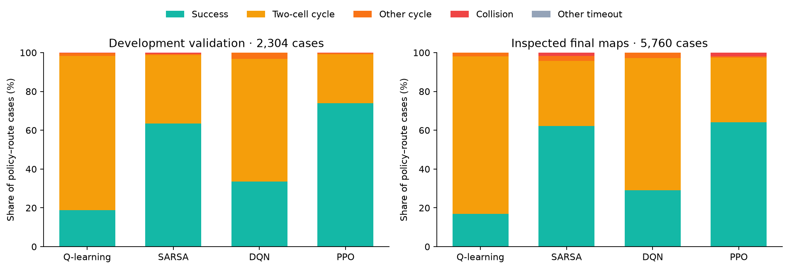
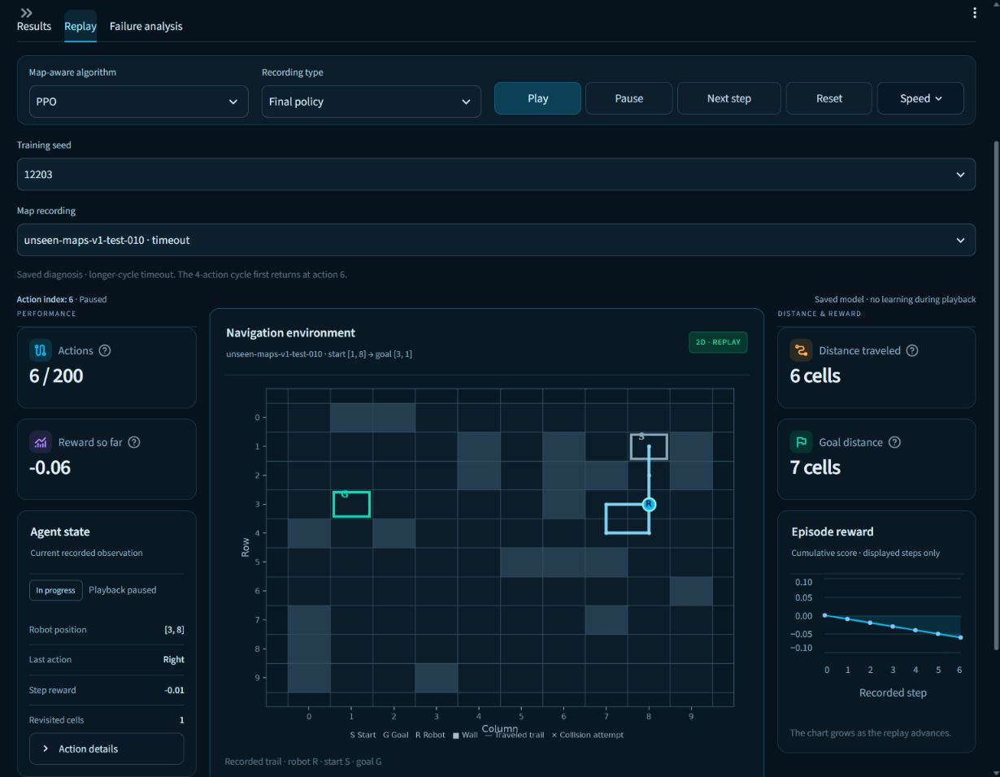

# Milestone 13. Saved-trajectory failure diagnosis

Completed 11 November 2026 under the [registered diagnostic protocol](milestone13_protocol.md).
The owner selected failure diagnosis after the completed unseen-map evaluation.
The study describes saved fixed-policy behavior, supplies route/seed summaries
and failure-location maps, and links illustrative cases to recorded replay events.

## Actual support and source checks

The calculation covers all twelve M11 main-policy validation recordings and all
twelve M12 learned-policy final recordings. Development has 2,304 policy–route
cases on four layouts, and inspected final data has 5,760 cases on ten layouts.
There are 8,064 cases and 908,298 recorded actions in total.
Each family has three trained policies. Development has 192 routes per policy,
while final data has 480. The cohorts remain separate in every result table.

The pipeline pins 449 source files, checks verified study
identities and the final seal, replays each stored transition through the core
environment and reconciles every run with its original metrics. The independent
recalculation reproduces every diagnostic row, group and example reference.
Model queries, new training interactions and new benchmark evaluation episodes
are all zero. The calculation retains 41 bounded links to existing
registered source replays.

## Measured failure composition

| Cohort | Algorithm | Cases | Successes | Two-cell timeouts | Longer-cycle timeouts | Wall collisions | Boundary collisions |
|---|---|---|---|---|---|---|---|
| Development | Q-learning | 576 | 109 | 457 | 9 | 1 | 0 |
| Development | SARSA | 576 | 365 | 203 | 4 | 4 | 0 |
| Development | DQN | 576 | 193 | 364 | 19 | 0 | 0 |
| Development | PPO | 576 | 426 | 145 | 4 | 1 | 0 |
| Inspected final | Q-learning | 1440 | 242 | 1171 | 26 | 1 | 0 |
| Inspected final | SARSA | 1440 | 894 | 484 | 38 | 24 | 0 |
| Inspected final | DQN | 1440 | 419 | 980 | 41 | 0 | 0 |
| Inspected final | PPO | 1440 | 923 | 479 | 10 | 23 | 5 |

All 4,434 timeouts satisfy the persistent-cycle definition. Of those, 4,283
are two-cell cycles, or 96.59%. The remaining 151 have longer periods. There
are zero stationary or non-periodic timeouts in these cohorts. The 59 collisions
comprise 54 wall attempts and five boundary attempts. All five boundary cases
belong to PPO final trajectories.

The controllers use a fixed map/goal and a stateless deterministic evaluation
action rule. There are at most 79 distinct position observations for a fixed
map and goal. Once a trajectory returns to an earlier observation, the same
saved action choices reproduce the cycle. The 200-action cap provides enough
steps to observe repeated traversals. The measurements locate those cycles and
quantify their frequency, periods and timing. The training causes and effectiveness
of a recovery intervention remain open research questions.



## Cycle timing and closest approach

A persistent cycle requires at least two complete repetitions and exact
repetition of the remaining state/action suffix. Indices count actions already
performed, starting at zero for the initial state. The first return closes the
first traversal. Actions after that return count observed repetition through
the recorded cutoff. This quantity describes the saved trace and supplies no
measured recovery benefit. Entry and distance statistics below pool looping
timeout cases within each family/cohort.

| Cohort | Algorithm | Timeouts | Mean entry action | Actions after first return | Share of timeout actions % | Median distinct cells | Mean minimum goal distance |
|---|---|---|---|---|---|---|---|
| Development | Q-learning | 466 | 2.62 | 91025 | 97.67 | 4.0 | 6.48 |
| Development | SARSA | 207 | 3.11 | 40333 | 97.42 | 4.0 | 7.71 |
| Development | DQN | 383 | 2.21 | 74941 | 97.83 | 4.0 | 7.39 |
| Development | PPO | 149 | 3.42 | 28982 | 97.26 | 5.0 | 6.79 |
| Inspected final | Q-learning | 1197 | 2.90 | 233459 | 97.52 | 4.0 | 6.72 |
| Inspected final | SARSA | 522 | 3.41 | 101481 | 97.20 | 5.0 | 8.21 |
| Inspected final | DQN | 1021 | 2.26 | 199740 | 97.82 | 4.0 | 7.52 |
| Inspected final | PPO | 489 | 3.42 | 95129 | 97.27 | 5.0 | 7.70 |

Across all timeout cases, 97.55% of actions occur after the first recorded
closed traversal. The cohort shares are 97.63% development and 97.52% final.
The new distance columns use shortest goal distances on the supplied obstacle
map. Minimum distance is the closest point reached anywhere in the stored
trajectory. First closest-approach action, final distance and distinct-cell
counts are retained for every episode in the JSON/CSV records.

| Cohort | Period 2 | Period 4 | Period 6 | Period 8 |
|---|---|---|---|---|
| Development | 1169 | 29 | 7 | 0 |
| Inspected final | 3114 | 82 | 30 | 3 |

## Route difficulty and training-seed variation

The original shortest-route bands are short for one to five actions, medium
for six to ten and long for eleven or more. Every policy uses the same number
of cases in each band. Means and sample SD average the three training seeds.
Routes within a policy/layout are dependent observations.

| Cohort | Algorithm | Band | Cases | Success % ± seed SD points | Two-cell timeouts | Longer-cycle timeouts | Collisions |
|---|---|---|---|---|---|---|---|
| Development | Q-learning | short | 192 | 50.00 ± 5.63 | 95 | 0 | 1 |
| Development | SARSA | short | 192 | 96.35 ± 0.90 | 5 | 0 | 2 |
| Development | DQN | short | 192 | 72.92 ± 13.29 | 48 | 4 | 0 |
| Development | PPO | short | 192 | 95.31 ± 4.69 | 7 | 2 | 0 |
| Inspected final | Q-learning | short | 480 | 39.17 ± 3.55 | 283 | 9 | 0 |
| Inspected final | SARSA | short | 480 | 95.00 ± 2.72 | 22 | 0 | 2 |
| Inspected final | DQN | short | 480 | 65.62 ± 8.20 | 160 | 5 | 0 |
| Inspected final | PPO | short | 480 | 92.08 ± 2.60 | 35 | 0 | 3 |
| Development | Q-learning | medium | 192 | 6.77 ± 1.80 | 172 | 7 | 0 |
| Development | SARSA | medium | 192 | 66.15 ± 2.39 | 65 | 0 | 0 |
| Development | DQN | medium | 192 | 22.40 ± 14.77 | 143 | 6 | 0 |
| Development | PPO | medium | 192 | 71.35 ± 7.05 | 54 | 1 | 0 |
| Inspected final | Q-learning | medium | 480 | 9.79 ± 2.60 | 427 | 6 | 0 |
| Inspected final | SARSA | medium | 480 | 63.33 ± 4.69 | 155 | 7 | 14 |
| Inspected final | DQN | medium | 480 | 17.71 ± 11.73 | 382 | 13 | 0 |
| Inspected final | PPO | medium | 480 | 63.12 ± 5.12 | 169 | 1 | 7 |
| Development | Q-learning | long | 192 | 0.00 ± 0.00 | 190 | 2 | 0 |
| Development | SARSA | long | 192 | 27.60 ± 4.77 | 133 | 4 | 2 |
| Development | DQN | long | 192 | 5.21 ± 3.61 | 173 | 9 | 0 |
| Development | PPO | long | 192 | 55.21 ± 7.05 | 84 | 1 | 1 |
| Inspected final | Q-learning | long | 480 | 1.46 ± 0.36 | 461 | 11 | 1 |
| Inspected final | SARSA | long | 480 | 27.92 ± 5.46 | 307 | 31 | 8 |
| Inspected final | DQN | long | 480 | 3.96 ± 4.73 | 438 | 23 | 0 |
| Inspected final | PPO | long | 480 | 37.08 ± 4.07 | 275 | 9 | 18 |

Across the four-family mixture, development success is 604/768 short cases
(78.65%), 320/768 medium (41.67%) and 169/768 long (22.01%). Inspected-final
success is 1,401/1,920 short (72.97%), 739/1,920 medium (38.49%) and 338/1,920
long (17.60%). These are descriptive mixtures of the registered policies.
The per-family table above preserves their different performance levels.

## Every policy and cohort

| Cohort | Algorithm | Seed | Cases | Optimal successes | Detour successes | Two-cell timeouts | Longer-cycle timeouts | Wall | Boundary |
|---|---|---|---|---|---|---|---|---|---|
| Development | Q-learning | 12101 | 192 | 37 | 3 | 152 | 0 | 0 | 0 |
| Development | Q-learning | 12203 | 192 | 31 | 0 | 157 | 4 | 0 | 0 |
| Development | Q-learning | 12301 | 192 | 35 | 3 | 148 | 5 | 1 | 0 |
| Development | SARSA | 12101 | 192 | 116 | 9 | 64 | 0 | 3 | 0 |
| Development | SARSA | 12203 | 192 | 110 | 7 | 73 | 2 | 0 | 0 |
| Development | SARSA | 12301 | 192 | 113 | 10 | 66 | 2 | 1 | 0 |
| Development | DQN | 12101 | 192 | 45 | 5 | 134 | 8 | 0 | 0 |
| Development | DQN | 12203 | 192 | 74 | 7 | 104 | 7 | 0 | 0 |
| Development | DQN | 12301 | 192 | 60 | 2 | 126 | 4 | 0 | 0 |
| Development | PPO | 12101 | 192 | 138 | 9 | 45 | 0 | 0 | 0 |
| Development | PPO | 12203 | 192 | 143 | 6 | 43 | 0 | 0 | 0 |
| Development | PPO | 12301 | 192 | 124 | 6 | 57 | 4 | 1 | 0 |
| Inspected final | Q-learning | 12101 | 480 | 69 | 2 | 405 | 3 | 1 | 0 |
| Inspected final | Q-learning | 12203 | 480 | 74 | 6 | 390 | 10 | 0 | 0 |
| Inspected final | Q-learning | 12301 | 480 | 85 | 6 | 376 | 13 | 0 | 0 |
| Inspected final | SARSA | 12101 | 480 | 271 | 22 | 166 | 13 | 8 | 0 |
| Inspected final | SARSA | 12203 | 480 | 273 | 17 | 161 | 18 | 11 | 0 |
| Inspected final | SARSA | 12301 | 480 | 294 | 17 | 157 | 7 | 5 | 0 |
| Inspected final | DQN | 12101 | 480 | 101 | 10 | 350 | 19 | 0 | 0 |
| Inspected final | DQN | 12203 | 480 | 153 | 19 | 301 | 7 | 0 | 0 |
| Inspected final | DQN | 12301 | 480 | 132 | 4 | 329 | 15 | 0 | 0 |
| Inspected final | PPO | 12101 | 480 | 305 | 23 | 139 | 2 | 9 | 2 |
| Inspected final | PPO | 12203 | 480 | 282 | 20 | 166 | 4 | 8 | 0 |
| Inspected final | PPO | 12301 | 480 | 269 | 24 | 174 | 4 | 6 | 3 |

## Failure locations and replay use

Open **Unseen maps**, select the shared-feature development or final study,
then choose **Failure analysis**. The page shows diagnostic composition,
per-seed/difficulty summaries and a selectable algorithm/map heatmap.
Each failed policy–route case contributes one location. Persistent cycles
use their entry cell, collisions use the last valid robot cell and other
timeouts use their final cell. Counts retain their map identity and include
zero-valued cells. Each selected map has 144 policy–route cases across three
seeds. The heatmap reports raw counts under this location rule.

Illustrative recordings are selected from existing registered replay examples,
using the first available example per run/category. Every option names its own
source map. **Replay this event** selects the correct algorithm, training seed
and recording, then pauses the existing player at the first cycle return or
terminal collision. The saved-diagnosis caption describes the full recording.
Playback telemetry continues to use the displayed prefix.

Native checks verified PPO seed12101 alternating [4,7] → [5,7] → [4,7] at
recorded actions 7, 8 and 9. A rapid example-selection/click opened PPO seed12203,
final map010, at its four-action cycle's first return at action6 and position
[3,8]. A boundary example opened PPO seed12101, map002, at collision action5,
with the robot at [0,3]. Development and final displays retained their respective
576 and 1,440 case support per family.

The browser check exposed a compressed chart and a stale-selection replay link.
Explicit chart sizing/shorter labels corrected the chart. The event callback
now reads submitted selection state, and diagnostic preferences persist across
view changes. A regression test submits a selection and click together for
both longer-cycle and collision cases. Corrected native checks pass at
1230×956 and 854×1000, with no horizontal document overflow. The viewport
override was reset.



## Artifacts, cost and verification

Calculation and export took 14.34 seconds. The latest complete
verification took 16.14 seconds. Derived study files occupy
approximately 7.56 MB.
Execution fits the registered 900-second calculation and 64 MiB artifact limits.
The study uses saved evidence and retains both the calculation-source hash and
latest verification-source hash. Verification timing, protocol compatibility
checks and UI fixes were completed after the initial calculation, and all
scientific records recompute exactly.

All 202 tests passed in 116.84 seconds. Synthetic traces cover two-state/four-state
cycles, transient prefixes, inconsistent action rejection, wall/boundary
collisions, optimal/detour successes and non-periodic cutoffs. Group tests
check equal seed weighting and zero-success groups. Source reconciliation
forbids policy loads, validates all 8,064 records and checks every seed CSV row.
UI tests cover event jumps for both cohorts, all four families and all three
seeds, caption identity, preference retention, pause on view changes, stale seek
rejection and quick selection/click submission.

All 14,181 pre-study protected files retain their hashes. Both the 114-file unseen
final release and 184-input original fixed-map archive pass their seals. Earlier
studies, original project documents, the energy project and sources are preserved.

The study directory is `artifacts/studies/unseen-map-diagnostics-v1/`.
Its `episodes.json` and `episodes.csv` contain the full diagnostic records,
`seeds.csv` contains all 24 cohort/policy seed rows, and `summary.json` contains
category rates, difficulty summaries and 41 source-example references. The
manifest pins all 449 inputs and derived outputs. A standalone figure, protocol
copy and verification record accompany the data.

Activate the project environment and run the following commands from the
navigation project directory.

```powershell
python -m robot_navigation.unseen_diagnostics build
python -m robot_navigation.unseen_diagnostics verify
python -m pytest -p no:cacheprovider -q
python -m streamlit run app/streamlit_app.py --server.port 8518
```

Compatible completed output is reused after input/output/protocol checksum
checks. Incomplete publication remains separate from completed results.
The completed-output reuse check preserved all eight study files. Raw-byte
checkout rules preserve the study and its registered live protocol. The
[milestone verification record](milestone13_verification.json) includes source
hashes, preservation results and native screenshot fingerprints.

## Interpretation limits and remaining work

This post hoc study uses already inspected cohorts and deterministic stateless
controllers. Its classification describes repeated behavior under that contract.
The sample spans three training seeds, four development layouts and ten final
layouts from one generator/task design. Learning-time exploration and future
memory-based controllers require their own diagnostic contracts.

The analysis identifies where and when failures occur. The training causes and
performance benefit of an intervention remain untested. A future improvement
study needs a registered change and fresh independent holdout. The existing
performance misses remain recorded in the M12 results.
