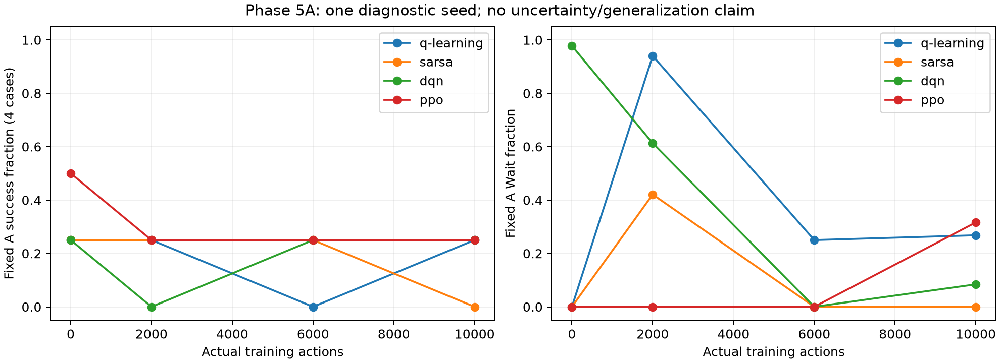

# Phase 5A: bounded learning-feasibility results

Measured 20 November 2026.

**Verdict: `REQUIRES_REPRESENTATION_OR_TRAINING_DIAGNOSIS`**. This is one diagnostic seed, not a main comparison or evidence of unseen-layout generalization.

## Branch, preservation and executed scope

Started from `45f3f389518226d3ab054eb3fd321625f7b2636a` on `feature/partial-dynamic-feasibility-v1`. The original dirty main workspace was kept separate. Pre-existing tracked source, configs, studies, models, reports and replay files were not edited. New work is in the Phase 5A fixture, ledger, diagnostics, runner, report, config, test and documentation files.

Training reservations: **40,000 / 40,000**; evaluation/control/composition reservations: **13,100 / 100,000**. Elapsed pilot wall time: **178.87 / 1,200 seconds**. The machine-readable protocol, per-algorithm settings and raw budget journal preserve exact actual accounting.

No confirmation seed, feature/reward change, full Phase 5 study, new final set, final evaluation or UI work was performed. Stage gates and unused budgets were respected.

## Latest assessed checkpoint per fixture

Four held-out start-goal cases per category on familiar fixture geometry. Entries use the latest actually assessed checkpoint for each category, never a selected best result. A missing category means its prerequisite gate or remaining budget prevented progression; it is not a measured failure. Later checkpoint states can differ across categories.

| Algorithm | Fixture | Checkpoint actions | Success | Collision | Timeout | Mean steps | Wait % | Longest Wait | Mean discovered cells |
| --- | --- | --- | --- | --- | --- | --- | --- | --- | --- |
| q-learning | A | 10000 | 1 | 0 | 3 | 150.25 | 26.79 | 161 | 42.25 |
| sarsa | A | 10000 | 0 | 2 | 2 | 105.25 | 0.0 | 0 | 34.75 |
| dqn | A | 10000 | 1 | 2 | 1 | 59.5 | 8.4 | 10 | 30.5 |
| ppo | A | 10000 | 1 | 0 | 3 | 150.25 | 31.61 | 190 | 34.0 |

## Functional controls

The same 20 diagnostic cases were used. Scripts are privileged mechanics demonstrations, not learned or fair operational policies. The online planner sees only the observation and can fail. Random is seeded and exploratory.

| Algorithm | Fixture | Checkpoint actions | Success | Collision | Timeout | Mean steps | Wait % | Longest Wait | Mean discovered cells |
| --- | --- | --- | --- | --- | --- | --- | --- | --- | --- |
| always-wait | A | control | 0 | 0 | 4 | 200.0 | 100.0 | 200 | 9.0 |
| always-wait | B | control | 0 | 0 | 4 | 200.0 | 100.0 | 200 | 7.0 |
| always-wait | C | control | 0 | 0 | 4 | 200.0 | 100.0 | 200 | 6.0 |
| always-wait | D | control | 0 | 0 | 4 | 200.0 | 100.0 | 200 | 7.0 |
| always-wait | E | control | 0 | 0 | 4 | 200.0 | 100.0 | 200 | 7.0 |
| random | A | control | 1 | 3 | 0 | 29.5 | 14.41 | 2 | 40.25 |
| random | B | control | 0 | 4 | 0 | 2.5 | 30.0 | 1 | 8.5 |
| random | C | control | 0 | 4 | 0 | 1.5 | 33.33 | 1 | 5.0 |
| random | D | control | 0 | 4 | 0 | 1.5 | 0.0 | 0 | 7.25 |
| random | E | control | 0 | 4 | 0 | 1.5 | 16.67 | 1 | 7.5 |
| online-planner | A | control | 4 | 0 | 0 | 1.0 | 0.0 | 0 | 14.0 |
| online-planner | B | control | 4 | 0 | 0 | 9.0 | 0.0 | 0 | 34.5 |
| online-planner | C | control | 4 | 0 | 0 | 12.5 | 44.0 | 7 | 26.0 |
| online-planner | D | control | 4 | 0 | 0 | 12.0 | 0.0 | 0 | 41.5 |
| online-planner | E | control | 4 | 0 | 0 | 10.0 | 0.0 | 0 | 30.5 |
| scripted-mechanics | A | control | 4 | 0 | 0 | 1.0 | 0.0 | 0 | 14.0 |
| scripted-mechanics | B | control | 4 | 0 | 0 | 9.0 | 0.0 | 0 | 35.0 |
| scripted-mechanics | C | control | 4 | 0 | 0 | 12.5 | 44.0 | 7 | 26.0 |
| scripted-mechanics | D | control | 4 | 0 | 0 | 10.0 | 20.0 | 4 | 31.5 |
| scripted-mechanics | E | control | 4 | 0 | 0 | 16.5 | 21.21 | 5 | 34.0 |

## Stage gates and failures

- **q-learning**: 10,000 training actions; basic gate False; status completed; Basic learning gate failed at the 10,000-action cap; no B/C/D/E progression.
- **sarsa**: 10,000 training actions; basic gate False; status completed; Basic learning gate failed at the 10,000-action cap; no B/C/D/E progression.
- **dqn**: 10,000 training actions; basic gate False; status completed; Basic learning gate failed at the 10,000-action cap; no B/C/D/E progression.
- **ppo**: 10,000 training actions; basic gate False; status completed; Basic learning gate failed at the 10,000-action cap; no B/C/D/E progression.

Every training/evaluation action distribution, length histogram, incomplete prefix, failure case, sensor/memory state, recovery denominator, model fingerprint and checkpoint is retained. Completed-episode training rates exclude incomplete curriculum/budget prefixes; overall executed returns and action counts include them. Evaluation and training behavior are never pooled.

## Actual training and update evidence

| Algorithm | Actions | Training goals | Training collisions | Training timeouts | Incomplete prefixes | Training Wait % | Up/Down/Left/Right/Wait | Updates (family-specific) | DQN replay goals |
| --- | --- | --- | --- | --- | --- | --- | --- | --- | --- |
| q-learning | 10000 | 126 | 89 | 20 | 1 | 21.13 | 1918/1909/2011/2049/2113 | 10000 | n/a |
| sarsa | 10000 | 186 | 117 | 13 | 1 | 15.4 | 1900/1848/2336/2376/1540 | 10000 | n/a |
| dqn | 10000 | 390 | 93 | 10 | 1 | 40.29 | 1361/1269/1635/1706/4029 | 2475 | 390 |
| ppo | 10000 | 188 | 211 | 1 | 1 | 18.51 | 2096/2035/1997/2021/1851 | 500 | n/a |

## D: privileged hindsight diagnostics

| Method | Case | Outcome | Actions | Clairvoyant actions | Excess if success |
| --- | --- | --- | --- | --- | --- |
| always-wait | phase5a-handwritten-fixtures-v1-D-evaluation-00 | timeout | 200 | 9 | None |
| always-wait | phase5a-handwritten-fixtures-v1-D-evaluation-01 | timeout | 200 | 11 | None |
| always-wait | phase5a-handwritten-fixtures-v1-D-evaluation-02 | timeout | 200 | 9 | None |
| always-wait | phase5a-handwritten-fixtures-v1-D-evaluation-03 | timeout | 200 | 11 | None |
| online-planner | phase5a-handwritten-fixtures-v1-D-evaluation-00 | success | 9 | 9 | 0 |
| online-planner | phase5a-handwritten-fixtures-v1-D-evaluation-01 | success | 15 | 11 | 4 |
| online-planner | phase5a-handwritten-fixtures-v1-D-evaluation-02 | success | 9 | 9 | 0 |
| online-planner | phase5a-handwritten-fixtures-v1-D-evaluation-03 | success | 15 | 11 | 4 |
| random | phase5a-handwritten-fixtures-v1-D-evaluation-00 | collision | 1 | 9 | None |
| random | phase5a-handwritten-fixtures-v1-D-evaluation-01 | collision | 1 | 11 | None |
| random | phase5a-handwritten-fixtures-v1-D-evaluation-02 | collision | 3 | 9 | None |
| random | phase5a-handwritten-fixtures-v1-D-evaluation-03 | collision | 1 | 11 | None |
| scripted-mechanics | phase5a-handwritten-fixtures-v1-D-evaluation-00 | success | 9 | 9 | 0 |
| scripted-mechanics | phase5a-handwritten-fixtures-v1-D-evaluation-01 | success | 11 | 11 | 0 |
| scripted-mechanics | phase5a-handwritten-fixtures-v1-D-evaluation-02 | success | 9 | 9 | 0 |
| scripted-mechanics | phase5a-handwritten-fixtures-v1-D-evaluation-03 | success | 11 | 11 | 0 |

The reference knows the complete future schedule and is evaluator-only. Excess is undefined for failures. These values do not prove that an observation-only choice was irrational.

## What the robot knew in selected failures

| Algorithm | Example | Action index | Robot/goal | N/S/E/W rays | Known cells | Chosen action | U/D/L/R/Wait scores or probabilities |
| --- | --- | --- | --- | --- | --- | --- | --- |
| q-learning | first_sustained_wait | 40 | [3, 5, 3, 7] | [0.0, 0.0, 0.0, 0.0] | 80 | 4 | 1.548/1.576/1.605/1.594/1.609 |
| sarsa | first_attempted_collision | 14 | [3, 0, 2, 3] | [0.0, 0.0, 0.0, 0.5] | 32 | 2 | 3.698/4.272/4.491/4.418/3.392 |
| dqn | first_sustained_wait | 4 | [3, 0, 2, 3] | [0.0, 0.0, 0.0, 0.5] | 22 | 4 | 5.068/5.287/5.214/5.315/5.392 |
| ppo | first_sustained_wait | 11 | [5, 5, 2, 3] | [0.0, 0.0, 0.0, 0.0] | 43 | 4 | 0.200/0.200/0.200/0.195/0.204 |

These are bounded illustrative failure links, not a representative sample or a causal diagnosis. They display the actual pre-action observation and checkpoint decision, without an obstacle-type label or future schedule.

## Learning diagnostics and competing explanations

The fixed reward schedule gives -2 undiscounted return for 200 Wait actions, -5.01 for an immediate collision, and +9.99 for a one-action arrival. Discounted examples at gamma .99 are in `reward-sanity.json`. This shows plausible incentives, not a causal explanation for a learned stall. No reward ablation was run.

The engineering gates demonstrate adjacent-goal success/reward, five valid action IDs, unchanged Wait execution, sensor/memory/leakage rules, SARSA next-action/reset semantics, SB3 terminal/truncation bootstrapping, model reload and inference immutability. The zero-linear-weight greedy tie selects Up, while exploratory ties and epsilon exploration sample all five actions. See the validation logs and tests.

Successful goal rewards, actual exploratory directions, DQN buffer goal counts, finite updates and state-specific values/probabilities are recorded at each checkpoint. Interpret failures in this order: lack of successful exploration; weak state-dependent value separation or affine interaction capacity; finite training budget; and reward/cap hypotheses. The data can support or weaken these explanations but this single-seed design does not isolate any one cause.

The shared feature transform retains all 409 inputs. Immediate versus farther right obstacles are distinguishable. A controlled independent goal/occupancy parallelogram cannot support a strict XOR score difference with an affine model; those synthetic labels are not asserted optimal navigation actions. Therefore this probe illustrates a capacity limitation, not proof that these tasks are unlearnable. Neural capacity and compute differ.

DQN continuation uses the declared SB3 cumulative-endpoint exploration schedule, which can rise at a continued learn call; linear exploration uses its declared fixed global schedule. Actual epsilon is logged. Python/NumPy/Torch RNG states are restored around checkpoint reload and assessment so monitoring cannot reseed training.

## Scenario composition of the existing generated dataset

One unchanged observation-only OnlinePlanner trajectory per existing dynamic train/development case. Unimpeded timing is an evaluator counterfactual, not sensor visibility. Disconnection counts are cases, single-cell impacts are events; detour/disconnection flags can overlap across times. No final access.

| Measure | Count |
| --- | --- |
| actions | 2898 |
| nominal_events | 540 |
| initial_base_path_events | 202 |
| unimpeded_near_ray_timing_proxy | 64 |
| unimpeded_arrival_active_events | 28 |
| single_cell_disconnecting_impacts | 16 |
| observed_at_executed_decision | 75 |
| observed_relevant_at_executed_decision | 34 |
| no_relevant_event_observed | 147 |
| temporarily_disconnected_during_relevant_window | 6 |
| detour_available_during_relevant_window | 33 |
| no_legal_move_during_relevant_window | 0 |
| events_start_at_or_after_route_end | 305 |
| events_with_suppression | 11 |
| applied_event_count | 235 |
| detected_event_count | 77 |
| events_never_observed | 463 |
| suppressed_activation_ticks | 11 |
| recovery_opportunities | 34 |
| recoveries | 31 |

Duration counts: `{'3': 84, '4': 86, '5': 102, '6': 88, '7': 87, '8': 93}`. Activation-step counts: `{'0': 15, '1': 12, '2': 14, '3': 10, '4': 14, '5': 10, '6': 33, '7': 41, '8': 29, '9': 21, '10': 20, '11': 34, '12': 28, '13': 35, '14': 37, '15': 28, '16': 23, '17': 29, '18': 29, '19': 13, '20': 14, '21': 9, '22': 16, '23': 12, '24': 14}`.

The 16/540 single-cell impact figure counts hypothetical event removals, not episodes requiring Wait. Realized reference trajectories expose different windows. Detour and disconnection flags can both occur in one episode. Routes ending before nominal activation and suppressed ticks remain visible. The unimpeded near-ray counterfactual is geometric proximity, not an observed sensor detection or hidden map supplied to a learner.

## Proposal only: a controlled representation follow-up

If weak behavior remains, propose `partial-visible-relative-v2`, retaining raw 409 plus bias (1), relative goal (2), four neighboring occupancy one-hots (12), their ages/visits/streaks (12), and goal-sector (9) by neighbor occupancy (12) conjunctions (108): **644 features** total. Bounds are known; unknown remains distinct; all values derive only from the existing observation. No hidden lifetime/type or true-map feature is permitted.

The 644 transform would be identical for all four families, with a matching vectorized neural extractor, versioned checkpoint metadata and leakage/parity tests. Linear matrices become 5 by 644; each 32-unit first neural layer gains 7,424 weights. Feature computation uses four bounded gathers and 108 categorical conjunctions. Register matched interactions, seeds, curriculum, optimizer settings, evaluation cases and capacity/cost reporting before execution. This is a proposal; no such extractor or ablation was trained.

A future reward ablation, if warranted, must receive its own reward/task identity and matched controls; this pilot provides no causal reward conclusion. Do not combine a feature and reward change into a claimed single-factor improvement.

## Proposal only: future benchmark stratification

A new `partial-dynamic-navigation-v2` could pre-register equal scenario quotas for unknown static, permanent-wall detours, initially mandatory Wait, short-detour/long-block, and long-detour/short-block cases. Cross these with familiar versus held-out layout conditions; unseen-dynamic is a condition, not a substitute for mechanism balance. Anchor nominal windows to independently seeded expected arrival ranges, never agent actions, and retain suppression and realized-exposure diagnostics.

Reject D4 overlap with all inspected layouts and diagnostic geometry; reserve/seal new final geometry and event manifests before substantive selection. Existing v1 manifests must remain intact. Counts, seeds, horizon and duration distributions require approval and a new registered study; no new dataset was generated here.

## Reproduce and inspect

From the application directory with its installed environment:

```powershell
.\.venv\Scripts\python.exe -m robot_navigation.partial_commands validate
.\.venv\Scripts\python.exe -m robot_navigation.partial_feasibility register
.\.venv\Scripts\python.exe -m robot_navigation.partial_feasibility run
.\.venv\Scripts\python.exe -m robot_navigation.partial_feasibility audit
.\.venv\Scripts\python.exe -m robot_navigation.partial_feasibility report
```

Registration/execution refuse an existing attempt; reproduce training only in a fresh authorized workspace, not by overwriting evidence or treating retries as free. `audit` is read-only over measured records, apart from a new verification file. It checks hashes, exact replays, checkpoints, saved decisions, immutable training prefixes, summaries and budgets.

[Registered machine-readable protocol](../artifacts/partial-dynamic-navigation-v1/feasibility-pilot-v1/phase5a_pilot_protocol.json), [raw summary](../artifacts/partial-dynamic-navigation-v1/feasibility-pilot-v1/summary.json), [output hashes](../artifacts/partial-dynamic-navigation-v1/feasibility-pilot-v1/outputs.json), [replay verification](../artifacts/partial-dynamic-navigation-v1/feasibility-pilot-v1/replay-verification.json), [per-fixture CSV](../artifacts/partial-dynamic-navigation-v1/feasibility-pilot-v1/latest-fixture-results.csv).

The next step is a narrowly registered diagnosis or protocol review according to the verdict. Further training, final reserve creation/evaluation and Phase 6 still need authorization.

## Reviewed gate verdict and analytic qualification

See the [post-hoc diagnosis](partial_feasibility_diagnosis_v1.md) for G1-G5, actual competing explanations, explicit composition denominators, and the zero-learning affine policy-class witness. It shows that the initial A decisions are representable without establishing that the TD learner can acquire them. No measured outcome or registered science setting was changed.

## Verified execution and diagnostic figure

Final full regressions: **305 passed**. Final focused gates: **70 passed**. The independent replay audit verified **40,000 training actions and 13,100 actions across 324 evaluation/control/composition episodes**, with matching checkpoint decisions, immutable training prefixes and reconciled budget reservations. No model attempt was retried or interrupted. Four incomplete final training-episode prefixes remain explicitly incomplete.



Lines connect only registered checkpoints on four fixed diagnostic cases; they are descriptive and carry no uncertainty estimate. See [delivery verification](../artifacts/partial-dynamic-navigation-v1/feasibility-pilot-v1/delivery-verification.json) for preservation, test counts and source/evidence hashes.
