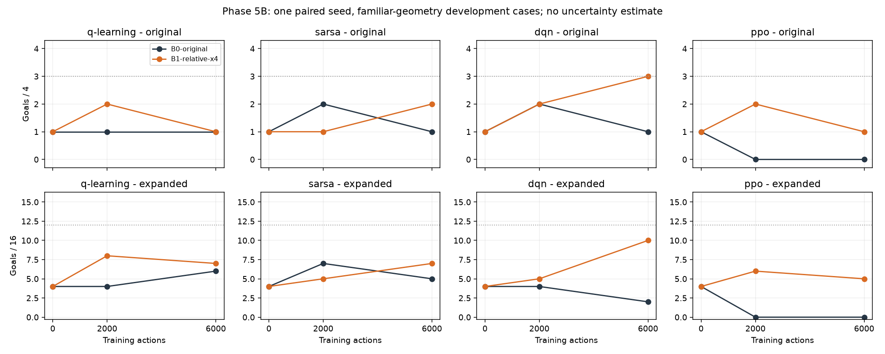

# Phase 5B: A-only navigation learning diagnosis

## 1. Executive verdict and scope

**SCALING_HYPOTHESIS_NOT_SUPPORTED**. Families passing the complete predeclared screen:
**0 / 4**. Trial status: **completed**.
This is one seed (23021), two feature arms and fixed development pairs on familiar
open geometry. It is not full Phase 5, unseen-layout generalization, statistical
evidence across seeds or a ranking of algorithm families. No obstacle/dynamic
training, new final/test evaluation, UI work or main merge was performed.

## 2. Phase 5A facts and new measurements

The archived [Phase 5A results](partial_feasibility_results.md) and
[diagnosis](partial_feasibility_diagnosis_v1.md) remain unchanged: final original
A successes were Q-learning 1/4, SARSA 0/4, DQN 1/4 and PPO 1/4, all failing that
study's improvement gate. These old seed-23001 runs are not matched B0 controls.
The tables below are new, separately registered seed-23021 measurements.

## 3. Zero-learning audit

See the [preflight diagnosis](partial_phase5b_diagnosis.md),
[raw zero-learning audit](../artifacts/partial-dynamic-navigation-v1/phase5b-a-only-v1/zero-learning-diagnosis/zero-learning-audit.json)
and [pretraining gates](../artifacts/partial-dynamic-navigation-v1/phase5b-a-only-v1/pretraining-gates.json). Old linear TD/RNG
reconstruction exactly matched all archived weights. Real terminal/truncated
targets, rotations, feature ordering, information boundaries and parity passed.
Relative-goal energy is small; that is a hypothesis, not a causal finding.

## 4. Registered design

The [protocol](partial_phase5b_protocol.md) and
[sealed manifest](../artifacts/partial-dynamic-navigation-v1/phase5b-a-only-v1/manifest.json) fix B0 original 412 features versus
B1 with only the final two coordinates multiplied by four. Raw observations,
task/rewards/model settings and eight original training pairs are unchanged.
Original A has four inspected development pairs; expanded A has 16 registered
additional pairs: balanced directions, one/two-step distances and quadrants,
with no duplicate training/evaluation pairs. No outcome-dependent case selection.
Linear methods are semi-gradient approximations, not tabular. The old 10k linear
epsilon horizon remains fixed; DQN keeps its declared continuation schedule.

## 5. Every registered checkpoint and panel

| algorithm | arm | actions | panel | success | collision | timeout | denominator | mean_steps | median_steps | wait_percent | longest_wait | revisits | oscillations | first_goal_directed |
| --- | --- | --- | --- | --- | --- | --- | --- | --- | --- | --- | --- | --- | --- | --- |
| q-learning | B0-original | 0 | original | 1 | 3 | 0 | 4 | 4.75 | 5.5 | 0.0 | 0 | 0 | 0 | 1 |
| q-learning | B0-original | 0 | expanded | 4 | 12 | 0 | 16 | 3.75 | 2.5 | 0.0 | 0 | 0 | 0 | 4 |
| q-learning | B0-original | 2000 | original | 1 | 0 | 3 | 4 | 150.25 | 200.0 | 92.346 | 190 | 20 | 3 | 1 |
| q-learning | B0-original | 2000 | expanded | 4 | 5 | 7 | 16 | 89.188 | 7.0 | 88.928 | 198 | 54 | 12 | 4 |
| q-learning | B0-original | 6000 | original | 1 | 0 | 3 | 4 | 150.25 | 200.0 | 61.564 | 186 | 205 | 98 | 1 |
| q-learning | B0-original | 6000 | expanded | 6 | 0 | 10 | 16 | 126.188 | 200.0 | 26.944 | 188 | 1343 | 778 | 6 |
| q-learning | B1-relative-x4 | 0 | original | 1 | 3 | 0 | 4 | 4.75 | 5.5 | 0.0 | 0 | 0 | 0 | 1 |
| q-learning | B1-relative-x4 | 0 | expanded | 4 | 12 | 0 | 16 | 3.75 | 2.5 | 0.0 | 0 | 0 | 0 | 4 |
| q-learning | B1-relative-x4 | 2000 | original | 2 | 0 | 2 | 4 | 100.5 | 100.5 | 0.0 | 0 | 395 | 391 | 2 |
| q-learning | B1-relative-x4 | 2000 | expanded | 8 | 0 | 8 | 16 | 111.312 | 184.0 | 0.0 | 0 | 1736 | 1717 | 10 |
| q-learning | B1-relative-x4 | 6000 | original | 1 | 0 | 3 | 4 | 150.25 | 200.0 | 33.111 | 199 | 389 | 376 | 1 |
| q-learning | B1-relative-x4 | 6000 | expanded | 7 | 0 | 9 | 16 | 113.312 | 200.0 | 32.101 | 200 | 1180 | 1159 | 8 |
| sarsa | B0-original | 0 | original | 1 | 3 | 0 | 4 | 4.75 | 5.5 | 0.0 | 0 | 0 | 0 | 1 |
| sarsa | B0-original | 0 | expanded | 4 | 12 | 0 | 16 | 3.75 | 2.5 | 0.0 | 0 | 0 | 0 | 4 |
| sarsa | B0-original | 2000 | original | 2 | 1 | 1 | 4 | 52.25 | 4.0 | 90.431 | 189 | 9 | 2 | 1 |
| sarsa | B0-original | 2000 | expanded | 7 | 1 | 8 | 16 | 101.75 | 107.5 | 69.902 | 193 | 408 | 394 | 6 |
| sarsa | B0-original | 6000 | original | 1 | 0 | 3 | 4 | 150.25 | 200.0 | 90.017 | 189 | 5 | 1 | 1 |
| sarsa | B0-original | 6000 | expanded | 5 | 9 | 2 | 16 | 32.188 | 6.0 | 59.806 | 179 | 63 | 8 | 4 |
| sarsa | B1-relative-x4 | 0 | original | 1 | 3 | 0 | 4 | 4.75 | 5.5 | 0.0 | 0 | 0 | 0 | 1 |
| sarsa | B1-relative-x4 | 0 | expanded | 4 | 12 | 0 | 16 | 3.75 | 2.5 | 0.0 | 0 | 0 | 0 | 4 |
| sarsa | B1-relative-x4 | 2000 | original | 1 | 0 | 3 | 4 | 150.25 | 200.0 | 0.0 | 0 | 592 | 530 | 1 |
| sarsa | B1-relative-x4 | 2000 | expanded | 5 | 4 | 7 | 16 | 90.062 | 14.0 | 0.069 | 1 | 1382 | 1196 | 4 |
| sarsa | B1-relative-x4 | 6000 | original | 2 | 0 | 2 | 4 | 100.5 | 100.5 | 0.0 | 0 | 394 | 320 | 2 |
| sarsa | B1-relative-x4 | 6000 | expanded | 7 | 1 | 8 | 16 | 100.938 | 101.5 | 31.146 | 195 | 1057 | 1024 | 7 |
| dqn | B0-original | 0 | original | 1 | 3 | 0 | 4 | 4.75 | 5.5 | 0.0 | 0 | 0 | 0 | 1 |
| dqn | B0-original | 0 | expanded | 4 | 12 | 0 | 16 | 4.375 | 3.5 | 0.0 | 0 | 0 | 0 | 4 |
| dqn | B0-original | 2000 | original | 2 | 0 | 2 | 4 | 102.0 | 103.5 | 87.5 | 195 | 26 | 7 | 1 |
| dqn | B0-original | 2000 | expanded | 4 | 4 | 8 | 16 | 103.0 | 110.0 | 83.192 | 195 | 156 | 112 | 3 |
| dqn | B0-original | 6000 | original | 1 | 0 | 3 | 4 | 150.25 | 200.0 | 65.058 | 200 | 188 | 140 | 1 |
| dqn | B0-original | 6000 | expanded | 2 | 2 | 12 | 16 | 150.875 | 200.0 | 86.413 | 200 | 288 | 222 | 3 |
| dqn | B1-relative-x4 | 0 | original | 1 | 3 | 0 | 4 | 4.75 | 5.5 | 0.0 | 0 | 0 | 0 | 1 |
| dqn | B1-relative-x4 | 0 | expanded | 4 | 12 | 0 | 16 | 4.375 | 3.5 | 0.0 | 0 | 0 | 0 | 4 |
| dqn | B1-relative-x4 | 2000 | original | 2 | 0 | 2 | 4 | 101.0 | 101.5 | 14.356 | 11 | 335 | 294 | 1 |
| dqn | B1-relative-x4 | 2000 | expanded | 5 | 1 | 10 | 16 | 128.062 | 200.0 | 45.876 | 199 | 1010 | 826 | 5 |
| dqn | B1-relative-x4 | 6000 | original | 3 | 0 | 1 | 4 | 58.25 | 16.0 | 0.0 | 0 | 210 | 66 | 2 |
| dqn | B1-relative-x4 | 6000 | expanded | 10 | 0 | 6 | 16 | 88.062 | 14.5 | 0.0 | 0 | 1331 | 1101 | 6 |
| ppo | B0-original | 0 | original | 1 | 1 | 2 | 4 | 103.5 | 106.5 | 96.618 | 198 | 0 | 0 | 1 |
| ppo | B0-original | 0 | expanded | 4 | 6 | 6 | 16 | 76.938 | 6.5 | 96.344 | 199 | 3 | 0 | 4 |
| ppo | B0-original | 2000 | original | 0 | 0 | 4 | 4 | 200.0 | 200.0 | 100.0 | 200 | 0 | 0 | 0 |
| ppo | B0-original | 2000 | expanded | 0 | 0 | 16 | 16 | 200.0 | 200.0 | 100.0 | 200 | 0 | 0 | 0 |
| ppo | B0-original | 6000 | original | 0 | 0 | 4 | 4 | 200.0 | 200.0 | 100.0 | 200 | 0 | 0 | 0 |
| ppo | B0-original | 6000 | expanded | 0 | 0 | 16 | 16 | 200.0 | 200.0 | 100.0 | 200 | 0 | 0 | 0 |
| ppo | B1-relative-x4 | 0 | original | 1 | 1 | 2 | 4 | 106.0 | 111.5 | 96.934 | 198 | 0 | 0 | 1 |
| ppo | B1-relative-x4 | 0 | expanded | 4 | 4 | 8 | 16 | 101.062 | 103.0 | 97.835 | 200 | 0 | 0 | 4 |
| ppo | B1-relative-x4 | 2000 | original | 2 | 0 | 2 | 4 | 106.0 | 111.5 | 0.0 | 0 | 410 | 283 | 1 |
| ppo | B1-relative-x4 | 2000 | expanded | 6 | 1 | 9 | 16 | 116.188 | 200.0 | 0.0 | 0 | 1788 | 1209 | 6 |
| ppo | B1-relative-x4 | 6000 | original | 1 | 0 | 3 | 4 | 150.25 | 200.0 | 64.06 | 188 | 204 | 67 | 1 |
| ppo | B1-relative-x4 | 6000 | expanded | 5 | 5 | 6 | 16 | 76.125 | 2.5 | 31.691 | 189 | 789 | 633 | 4 |

Denominators are exact. No earlier checkpoint replaces the final 6k boundary.
Full per-direction/distance/quadrant/edge-band breakdowns, return and episode
length distributions and initial action values are in each checkpoint summary.

### Training, kept separate from deterministic assessment

| Family | Arm | Actions | Goals | Collisions | Timeouts | Incomplete prefixes | Wait % | Observed updates | Training seconds |
| --- | --- | --- | --- | --- | --- | --- | --- | --- | --- |
| q-learning | B0-original | 6000 | 104 | 82 | 4 | 1 | 22.35 | 6000 | 14.22 |
| q-learning | B1-relative-x4 | 6000 | 124 | 63 | 7 | 1 | 18.93 | 6000 | 15.59 |
| sarsa | B0-original | 6000 | 95 | 102 | 5 | 1 | 16.98 | 6000 | 13.291 |
| sarsa | B1-relative-x4 | 6000 | 134 | 82 | 6 | 1 | 16.63 | 6000 | 13.315 |
| dqn | B0-original | 6000 | 159 | 81 | 4 | 0 | 38.88 | 1475 | 20.227 |
| dqn | B1-relative-x4 | 6000 | 444 | 59 | 2 | 1 | 29.8 | 1475 | 19.911 |
| ppo | B0-original | 6000 | 81 | 135 | 0 | 1 | 26.45 | 600 | 21.979 |
| ppo | B1-relative-x4 | 6000 | 106 | 145 | 0 | 1 | 20.42 | 600 | 21.016 |

Linear update counts, DQN gradient steps and PPO optimizer steps/epochs/rollouts
are distinct compute units. Training seconds include action recording and live
instrumentation; they exclude assessment and checkpoint serialization.

## 6. Permitted-information success and failure examples

| Family | Arm | Outcome | Actions | Robot/goal coordinates | Initial action | Goal-direction margin |
| --- | --- | --- | --- | --- | --- | --- |
| q-learning | B0-original | success | 1 | [6, 6, 7, 6] | 1 | 0.06474 |
| q-learning | B0-original | timeout | 200 | [3, 3, 2, 3] | 1 | -0.16138 |
| q-learning | B1-relative-x4 | success | 1 | [6, 3, 6, 2] | 2 | 0.22562 |
| q-learning | B1-relative-x4 | timeout | 200 | [3, 3, 2, 3] | 2 | -0.12991 |
| sarsa | B0-original | success | 1 | [3, 3, 2, 3] | 0 | 0.57807 |
| sarsa | B0-original | collision | 7 | [6, 0, 7, 0] | 0 | -1.2105 |
| sarsa | B0-original | timeout | 200 | [6, 6, 7, 6] | 0 | -1.40817 |
| sarsa | B1-relative-x4 | success | 1 | [6, 6, 7, 6] | 1 | 0.06932 |
| sarsa | B1-relative-x4 | collision | 3 | [1, 7, 0, 7] | 3 | -0.55547 |
| sarsa | B1-relative-x4 | timeout | 200 | [3, 3, 2, 3] | 3 | -0.00692 |
| dqn | B0-original | success | 1 | [6, 6, 7, 6] | 1 | 0.12613 |
| dqn | B0-original | collision | 6 | [6, 9, 8, 9] | 1 | 0.00384 |
| dqn | B0-original | timeout | 200 | [3, 3, 2, 3] | 2 | -0.32219 |
| dqn | B1-relative-x4 | success | 1 | [6, 6, 7, 6] | 1 | 0.24371 |
| dqn | B1-relative-x4 | timeout | 200 | [3, 3, 2, 3] | 2 | -0.01137 |
| ppo | B0-original | timeout | 200 | [3, 3, 2, 3] | 4 | -0.0667 |
| ppo | B1-relative-x4 | success | 1 | [3, 3, 2, 3] | 0 | 0.08193 |
| ppo | B1-relative-x4 | collision | 1 | [0, 2, 2, 2] | 0 | -0.0562 |
| ppo | B1-relative-x4 | timeout | 200 | [6, 6, 7, 6] | 0 | -0.16293 |

See [trajectory examples](../artifacts/partial-dynamic-navigation-v1/phase5b-a-only-v1/trajectory-examples.json) and raw traces
for the actual 409-value pre-action observations, scores/probabilities, rays,
memory and retained failures. Margins are Q differences or PPO probability
differences, not comparable scales across families. No true-map, scenario label,
remaining event duration or privileged optimal action is a learner input.

## 7. Within-family paired differences and fixed screen

| Family | Original B1-B0 | Expanded B1-B0 | Passed complete screen | Individual criteria |
| --- | --- | --- | --- | --- |
| q-learning | 0 | 1 | False | {'original_minimum': False, 'gain_over_b1_initial': False, 'original_gain_over_b0': False, 'expanded_minimum': False, 'expanded_gain_over_b0': False} |
| sarsa | 1 | 2 | False | {'original_minimum': False, 'gain_over_b1_initial': True, 'original_gain_over_b0': True, 'expanded_minimum': False, 'expanded_gain_over_b0': False} |
| dqn | 2 | 8 | False | {'original_minimum': True, 'gain_over_b1_initial': True, 'original_gain_over_b0': True, 'expanded_minimum': False, 'expanded_gain_over_b0': True} |
| ppo | 1 | 5 | False | {'original_minimum': False, 'gain_over_b1_initial': False, 'original_gain_over_b0': True, 'expanded_minimum': False, 'expanded_gain_over_b0': True} |

The screen requires B1 original >=3/4, +1 over its own untrained checkpoint and
matched B0 final; expanded >=12/16 and +4 over B0 final; all integrity gates pass.
The [exact per-case paired table](../artifacts/partial-dynamic-navigation-v1/phase5b-a-only-v1/paired-results.csv) retains
success-to-failure and failure-to-success changes, collisions, Wait and loops.
One paired seed cannot establish a cross-seed effect. Finite coverage, feature
conditioning, normalized update magnitudes, optimization and familiar-pair
transfer remain alternatives. Dynamic composition is irrelevant to open A.

## 8. Runtime, resources and independent audit

Training reservations: **48000 / 48,000**.
Assessment/control reservations: **41761 / 100,000**.
Primary wall: **433.909 / 1,800 seconds**.
Each arm cap: 300 seconds. Resources: `{'cpu_user_seconds': 394.234375, 'cpu_system_seconds': 19.03125, 'working_set_bytes': 955731968, 'peak_working_set_bytes': 1114034176}`.
These process measurements include recording/evaluation, not model-only costs.
Post-run audits/regressions are outside the primary clock and add no learning.

Audit: `{'status': 'passed', 'training_actions': {'q-learning/B0-original': 6000, 'q-learning/B1-relative-x4': 6000, 'sarsa/B0-original': 6000, 'sarsa/B1-relative-x4': 6000, 'dqn/B0-original': 6000, 'dqn/B1-relative-x4': 6000, 'ppo/B0-original': 6000, 'ppo/B1-relative-x4': 6000}, 'training_total': 48000, 'evaluation_actions': 41761, 'reserved_training': {'q-learning/B0-original': 6000, 'q-learning/B1-relative-x4': 6000, 'sarsa/B0-original': 6000, 'sarsa/B1-relative-x4': 6000, 'dqn/B0-original': 6000, 'dqn/B1-relative-x4': 6000, 'ppo/B0-original': 6000, 'ppo/B1-relative-x4': 6000}, 'reserved_evaluation': 41761, 'evaluation_episodes': 520, 'checkpoint_decision_audits': 24, 'case_stream_prefixes': {'q-learning': {'shared_episode_prefix': 191, 'identical': True, 'B0_episodes': 191, 'B1_episodes': 195}, 'sarsa': {'shared_episode_prefix': 203, 'identical': True, 'B0_episodes': 203, 'B1_episodes': 223}, 'dqn': {'shared_episode_prefix': 245, 'identical': True, 'B0_episodes': 245, 'B1_episodes': 506}, 'ppo': {'shared_episode_prefix': 217, 'identical': True, 'B0_episodes': 217, 'B1_episodes': 252}}, 'historical_preservation': {'checked': 9630, 'historical_files_changed': [], 'only_existing_file_edit': '.gitattributes: byte preservation for new Phase 5B brief'}, 'final_regressions': {'tests': 366, 'failures': 0, 'errors': 0, 'skipped': 0}, 'manifest_sha256': '088c5f4a4f01be0fd467e86de354b4acfaf768bff74ccc58b1c71d70bf4ea0e8', 'source_hashes_checked': 43, 'replay_scope': 'Exact environment/action/observation/reward/snapshot/flag/value/metric/prefix verification; no new learning'}`.

The [budget journal](../artifacts/partial-dynamic-navigation-v1/phase5b-a-only-v1/training-budget-ledger.jsonl),
[checkpoint hashes](../artifacts/partial-dynamic-navigation-v1/phase5b-a-only-v1/checkpoint-hashes.json),
[replay audit](../artifacts/partial-dynamic-navigation-v1/phase5b-a-only-v1/replay-audit.json),
[raw summary](../artifacts/partial-dynamic-navigation-v1/phase5b-a-only-v1/summary.json) and
[final verdict](../artifacts/partial-dynamic-navigation-v1/phase5b-a-only-v1/final-verdict.json) preserve exact accounting.
Compressed continuation state includes trainer RNG/optimizer/buffers; inference
checkpoints load strictly by feature version. Registration/execution refuse a
second attempt. All historical pins were rechecked after execution.

## 9. Gate decision and one next step

See [gate results](../artifacts/partial-dynamic-navigation-v1/phase5b-a-only-v1/gate-results.json). Engineering success is not
learning success. Remain at A and propose one separately registered optimization/coverage hypothesis for review before any further training.
No B/C/D/E, full Phase 5 or Phase 6 progression is authorized.

## Provenance and reproduction

Registered branch: `feature/phase5b-basic-navigation-diagnosis-v1`; reviewed base/head at registration:
`d3822423ffd6fa3c83f9a26fc15808fa9103e36c`. Source/config/case/dependency hashes and exact interpreter
are in the manifest; protocol SHA256 `088c5f4a4f01be0fd467e86de354b4acfaf768bff74ccc58b1c71d70bf4ea0e8`.
From the application root with the recorded interpreter and PYTHONPATH=src:

```powershell
python -m robot_navigation.partial_phase5b diagnose
python -m robot_navigation.partial_phase5b validate
python -m robot_navigation.partial_commands validate
python -m robot_navigation.partial_phase5b register
python -m robot_navigation.partial_phase5b run
python -m robot_navigation.partial_phase5b validate-postrun
python -m robot_navigation.partial_phase5b audit
python -m robot_navigation.partial_phase5b report
```

Do not rerun training into this existing namespace. Reproduction requires a fresh
separately authorized attempt/version and the same declared ceilings. Final commit
and push status are recorded separately in publication metadata, not retroactively
inserted into the frozen pre-run manifest.



## Reviewed case-level interpretation and controls

The following is separately labelled post-hoc report arithmetic. It adds zero
training or assessment actions and does not change any screening threshold.
See [analysis source](../developer/commands/phase5b_case_analysis_v1.py),
[derived results](../artifacts/partial-dynamic-navigation-v1/phase5b-a-only-v1/derived-analysis/case-outcomes-v1.json)
and its [source/input manifest](../artifacts/partial-dynamic-navigation-v1/phase5b-a-only-v1/derived-analysis/case-outcomes-manifest-v1.json).

### Fixed references, reported separately

| Reference | Panel | Goals | Episodes | Mean actions | Wait % | Longest Wait |
| --- | --- | --- | --- | --- | --- | --- |
| online-planner | original | 4 | 4 | 1.0 | 0.0 | 0 |
| online-planner | expanded | 16 | 16 | 1.5 | 0.0 | 0 |
| goal-direction-script | original | 4 | 4 | 1.0 | 0.0 | 0 |
| goal-direction-script | expanded | 16 | 16 | 1.5 | 0.0 | 0 |

The references used **56 actions / 40 episodes**; learned
checkpoint assessments used **41705 actions / 480 episodes**.
The script is an analytic mechanics demonstration, not learned evidence.
The planner receives only permitted observations. Their perfect performance on
these simple cases validates the fixture mechanics; it is not an RL outcome.

### Paired final-case changes

| Family | Panel | Failure to goal | Goal to failure | Goal retained | Failure retained |
| --- | --- | --- | --- | --- | --- |
| q-learning | original | 1 | 1 | 0 | 2 |
| q-learning | expanded | 5 | 4 | 2 | 5 |
| sarsa | original | 2 | 1 | 0 | 1 |
| sarsa | expanded | 5 | 3 | 2 | 6 |
| dqn | original | 2 | 0 | 1 | 1 |
| dqn | expanded | 8 | 0 | 2 | 6 |
| ppo | original | 1 | 0 | 0 | 3 |
| ppo | expanded | 5 | 0 | 0 | 11 |

Q-learning's expanded net +1 masks five newly successful and four newly failed
pairs. SARSA's expanded net +2 masks five gains and three losses. DQN's expanded
net +8 comprises eight newly successful pairs, two retained successes and six
retained failures. All comparisons are within family on identical fixed cases;
these are not IID replications or significance tests.

### Remaining failure mechanisms

DQN B1 completed 3/4 original and 10/16 expanded goals, improving over both its
untrained original count and matched B0 final. It nevertheless fails the fixed
12/16 expanded threshold. Expanded direction results were Up 3/4, Down 4/4,
Left 3/4 and Right 0/4. One- and two-step cases each achieved 5/8; edge and interior
cases each achieved 5/8. This is directional failure, not exclusively an edge or
distance effect. These tiny descriptive strata do not establish a cause.

All six expanded DQN B1 failures timed out with zero Wait actions. Their initial
goal-direction margins were negative. Final original success routes took
1, 1 and 31 actions for adjacent goals. Expanded successful routes took
1, 12, 2, 163, 1, 2, 2, 1, 17 and 8 actions; their minimum axis distances total
15 actions, versus 209 actually used. Thus even some successful deliveries were
inefficient. The 194-action success-only excess is evaluator-only descriptive
arithmetic on the open geometry, not a training label or an added screen.

PPO B0 ended with 100% Wait in both panels despite 81 exploratory training goals.
SARSA B1 used zero Wait in the original panel yet still timed out twice. Failure
therefore cannot be attributed solely to a missing goal reward or an all-Wait
incentive. All families sampled every action and performed finite updates.
Optimizer instrumentation and independent numerical checks retain actual clipped
gradients, update magnitudes and Adam counters; no historical gradients were
invented. See [numerical audit](../artifacts/partial-dynamic-navigation-v1/phase5b-a-only-v1/numerical-audit-v1.json).

The invertible scale changes signal magnitude and optimization geometry, not
available information or representability. Limited state-action coverage,
learned directional biases, nuisance memory channels, finite optimization and
transfer between the eight training pairs and inspected diagnostic pairs remain
plausible. The study does not isolate those alternatives or prove that a reward
change or a larger feature set is needed. Dynamic events cannot explain A.

### Timing and unfinished episode prefixes

| Family | Arm | Training seconds incl. recording | Whole arm seconds | Final incomplete prefixes |
| --- | --- | --- | --- | --- |
| q-learning | B0-original | 14.22 | 46.097 | 1 |
| q-learning | B1-relative-x4 | 15.59 | 47.127 | 1 |
| sarsa | B0-original | 13.291 | 39.443 | 1 |
| sarsa | B1-relative-x4 | 13.315 | 41.272 | 1 |
| dqn | B0-original | 20.227 | 59.966 | 0 |
| dqn | B1-relative-x4 | 19.911 | 52.245 | 1 |
| ppo | B0-original | 21.979 | 78.976 | 1 |
| ppo | B1-relative-x4 | 21.016 | 63.063 | 1 |

All eight arms completed, with no abort or retry. Seven final nonterminal
training episode prefixes were preserved and excluded from completed-episode
rates. DQN B0 instead ended on a real terminal transition; its immediate empty
autoreset is retained as a reset, not counted as an incomplete episode with actions.
Whole-arm time includes initial/final assessment and serialization; training time
includes instrumentation and recording. Neither is isolated accelerator compute.
Post-run tests and replay audits are outside the 433.909-second primary clock.

### Training action distribution, separate from greedy assessment

| Family | Arm | Up | Down | Left | Right | Wait |
| --- | --- | --- | --- | --- | --- | --- |
| q-learning | B0-original | 1085 | 1058 | 1233 | 1283 | 1341 |
| q-learning | B1-relative-x4 | 1227 | 1284 | 1164 | 1189 | 1136 |
| sarsa | B0-original | 1221 | 1165 | 1273 | 1322 | 1019 |
| sarsa | B1-relative-x4 | 1215 | 1220 | 1299 | 1268 | 998 |
| dqn | B0-original | 812 | 802 | 1085 | 968 | 2333 |
| dqn | B1-relative-x4 | 1029 | 986 | 1144 | 1053 | 1788 |
| ppo | B0-original | 1247 | 1227 | 952 | 987 | 1587 |
| ppo | B1-relative-x4 | 1386 | 1292 | 1057 | 1040 | 1225 |

The one proposed next step remains A-only: review a separately registered
state-action coverage/goal-conditioning diagnosis, focusing on directional
failures before authorizing further training. No independent-seed run, larger
feature expansion, changed reward, obstacle curriculum or full Phase 5 is started.

## Windows checkout note

The archived source snapshot contains long paths. Windows Git's default path
limit rejected staging without `-c core.longpaths=true`; the same unchanged
files were staged with that command-scoped option. Use Git long-path support
when checking out this branch on Windows. No trace or snapshot was renamed.
The root `.gitattributes` metadata hash uses LF-normalized content; registered
source/config/data and experimental evidence retain their exact-byte hashes.
