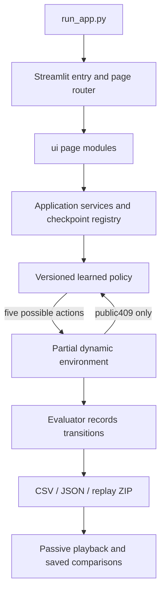

# How the robot navigation code works

Start with the user action you want to understand. The app has one entry point and five page modules. Pages call application services; services load a versioned policy and record an episode. Playback reads that record. It does not run the robot again.

Paths beginning with `src/` below are inside `autonomous-robot-navigation-rl/`.

## Read the project in this order

| Order | File | What to understand |
| --- | --- | --- |
| 1 | `run_app.py` | Chooses a Python interpreter, sets this checkout's source path and starts Streamlit. It does not train a model. |
| 2 | `app/streamlit_app.py` | Imports the single app renderer. |
| 3 | `src/robot_navigation/dynamic_demo_ui.py` | Routes the selected page to `ui/`; it contains no second implementation of those pages. |
| 4 | `src/robot_navigation/ui/` | `simulator`, `training`, `comparison`, and `reference` implement the five pages. `components.py` shares labels/navigation/cards; `styles.css` owns presentation; `guide.md` owns help text. |
| 5 | `src/robot_navigation/app_registry.py` | Lists only completed native runs, identifies their feature format, resolves saved selections and validates a checkpoint when loading it. |
| 6 | `src/robot_navigation/app_service.py` | Records a requested journey, reads saved frames, performs explicit development comparisons and manages training workers. |
| 7 | `src/robot_navigation/partial_dynamic_env.py` | Executes the five actions, applies occupancy events, detects collisions/goals and enforces the 200-action limit. |
| 8 | `src/robot_navigation/partial_sensor.py`, `partial_memory.py`, `partial_observation.py` | Convert a range-two scan and agent-local memory into the permitted 409-value observation. |
| 9 | `src/robot_navigation/phase3_features.py` | Builds public decision history and the saved Q-learning, SARSA, DQN and PPO architectures. |
| 10 | `src/robot_navigation/phase3_training.py` | Samples training cases, applies optional public-only training feedback, counts actual updates and saves fresh checkpoints. |
| 11 | `src/robot_navigation/phase3_evaluation.py` | Records evaluation episodes and computes official metrics/exports. Truth is evaluator-only. |
| 12 | `src/robot_navigation/phase3_study.py` | Runs the registered candidates, locks development selection and guards the once-used product holdout. This is a reproduction record, not a button to run again. |

## Follow one simulator journey

1. `ui/simulator.py` collects the map, obstacle mode, controller, seed and optional start/goal. The preview is human-only and now follows custom start/goal selections.
2. Run journey calls `app_service.generate`. `policy_for` loads exactly the selected native checkpoint, or an explicitly labeled non-RL reference.
3. The episode recorder resets the environment and calls `policy.act(observation.copy())`. The policy receives no scenario, event list, clearing schedule or true map.
4. `env.step(action)` returns the next public observation, official reward and ending flags. The evaluator separately stores a viewer snapshot; it is not a policy argument.
5. The completed episode is saved as compressed JSON. Play, Pause, Step, Back, Seek, Reset and End move a cursor through these saved transitions. Reset here resets playback, not training or the published experiment.

An RL failure stays a failure. The app never substitutes the separately labeled observed-map replanner to make an RL trajectory look successful.

## Understand observations before the algorithms

The environment is 10 by 10. Its public observation vector is:

| Python slice | Values | Meaning |
| --- | ---: | --- |
| `0:4` | 4 | Current row/column and goal row/column, divided by9 |
| `4:8` | 4 | Cardinal sensor distances, ordered North/South/East/West |
| `8:108` | 100 | Remembered occupancy: -1 unknown, 0 free, 1 occupied |
| `108:208` | 100 | Clipped age since each cell was observed |
| `208:308` | 100 | Clipped visit counts |
| `308:408` | 100 | Clipped consecutive blocked observations |
| `408` | 1 | Elapsed actions divided by200 |

Phase3's `PublicHistory` adds 16 values for eight previous decision positions, five for the last-action one-hot and one clipped Wait counter. This produces internal 431. Repeated positions during Wait are intentional evidence of inactivity, not duplicate dataset rows.

Features are arranged as five rows of 104 values, one row per possible action, for 520 total. A linear model scores each row using shared weights. The neural models receive the same versioned public-history representation. No action is removed because it looks risky: a learned policy can still choose a collision-causing move.

## Follow one learning update

| Family | Learning operation | Where to read |
| --- | --- | --- |
| Q-learning | Compare the chosen action value with reward plus the next greedy action's lagged target value. Clip TD error and bound weight norm. Refresh target weights every 100 updates. | `HistoryLinearPolicy.update` |
| SARSA | Use the next action actually sampled by the exploratory behavior policy in the TD target. | The same method's SARSA branch and the trainer's sampled next action |
| DQN | Store experience in replay, sample batches and optimize neural action values with a target network. | `HistoryDQNPolicy`, `HistoryQ`, `build_policy`, then the SB3 training call |
| PPO | Collect rollouts and optimize an actor/critic with a clipped policy objective and entropy. | `HistoryPPOPolicy`, `HistoryActorValue`, `build_policy`, then the SB3 training call |

`HistoryCurriculumEnv` samples only training cases. Its optional `liveness-v1` feedback uses public distance progress, recent revisits and observed adjacent alternatives. `info` separately retains official reward. Evaluation uses the original official reward only. A natural terminal stops bootstrapping; the existing external time-limit convention is preserved.

The trainer creates a new run directory, tracks physical environment actions and actual optimizer/TD updates, and checks cancellation and the one-hour cap. Failed or cancelled runs remain inspectable but cannot become selectable models. A save is an inference checkpoint, not an exact optimizer/replay-buffer resume snapshot.

## Keep selection and testing separate

- `phase3_data.train_dev()` reads the separate file containing 288 training and 32 development cases.
- The study compares the original Phase2 models and the fixed Phase3 candidates on development only. It saves selected IDs and weight hashes in a locked selection.
- The new product test has 64 cases from different structural families. The completed final assessment has one use marker. Do not remove the marker or rerun it and call the result unseen.
- `phase3_ui.saved()` reads CSV/JSON already on disk. Held-out viewing cannot train, change selection or execute evaluation.
- Successful-only Waits/steps exclude failures. All-action Wait rates include the failed episodes, often200 actions each. Always inspect both denominators.

The current saved test is one product panel/seed. It is not a guarantee about all warehouses, moving traffic, physical robots or future random seeds.

## Why some names and files remain

`product_features.py` is the Phase2 format; `phase3_features.py` is the new public-history format. They support different weight shapes. B0/B1 starters use another original feature format. These are compatible readers for historical native checkpoints, not separate old application modes.

Saved SB3 models contain Python module/class references. Renaming or merging their classes indiscriminately would break those models. Keep these import paths stable unless a deliberate versioned migration is designed. `core.py` is a small compatibility re-export of neutral utilities in `shared.py` for the same reason.

Phase2/Phase3 result manifests and raw source snapshots record the code that actually produced those runs. Formatting the active source does not rewrite those recorded hashes or make the new source the historically evaluated revision. The cleanup checks compare executable syntax with the delivered Phase3 source and load the original checkpoints; no retraining is needed for this cleanup.

Research data, saved models and reports remain in `runs/`, `artifacts/` and `archive/`. The clean editor workspace hides these from everyday editing and search; it does not delete them.

## Make a safe change

For presentation, edit `ui/`, its stylesheet or its guide. For model listing/loading, edit `app_registry.py`. For replay/job handling, edit `app_service.py`. Changes to observations, reward, policy features or training are experiment-contract changes and need deliberate new versioning and evaluation scope.

Run the focused compatibility/UI tests listed in [the cleanup validation receipt](cleanup-validation.md). They read saved product evidence and validate code; they do not start a new training study or execute the frozen holdout again. The [assignment audit](assignment-compliance-audit.md) separately identifies what the code demonstrates and what the team still has to supply for assessment.
